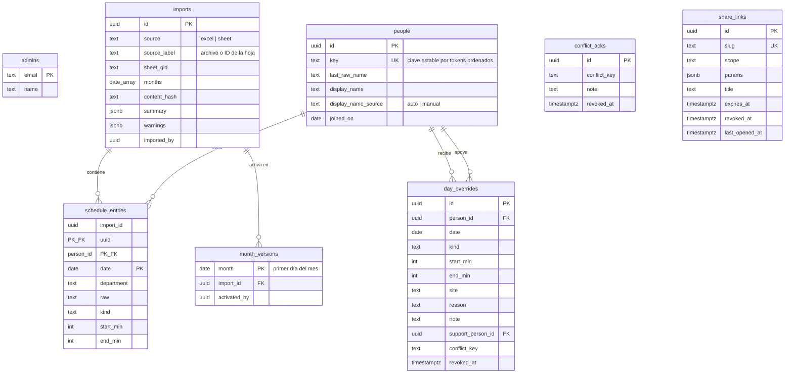

# Modelo de datos

Tablas, RLS y funciones RPC. Fuente: plan §5.6.

> **Estado: diseñado, no implementado.** Las migraciones se escriben en la **Fase 2**. Este archivo
> se actualiza en el mismo PR que cada migración (Definición de terminado).

## Diagrama

## Las tablas, una por una

| Tabla | Para qué | Detalle que importa |
|---|---|---|
| `admins` | Quién tiene acceso de jefatura | Se carga por SQL; **los correos no van en el repo** |
| `imports` | Una fila por publicación | `content_hash`: si coincide con el activo, no se publica otra vez |
| `month_versions` | La versión activa de cada mes | Es lo que leen panel, horario y enlaces. Permite volver atrás |
| `people` | Identidad estable entre meses | `key` por tokens ordenados; `display_name_source='manual'` se respeta en importaciones siguientes |
| `schedule_entries` | El horario tal como venía en la hoja | PK `(import_id, person_id, date)`. Se guarda `raw` además de lo interpretado |
| `day_overrides` | Los cambios de jefatura | **Índice único parcial** `(person_id, date) where revoked_at is null`: un solo cambio vigente por persona y día |
| `conflict_acks` | «Aceptar como está» | Lo único que se guarda de un conflicto ([ADR-0007](../adr/0007-conflictos-como-funciones-puras.md)) |
| `share_links` | Enlaces de solo lectura | `scope` + `params` definen qué muestra; `expires_at` y `revoked_at` lo cierran |

Deshacer un cambio es poner `revoked_at`. Editarlo es revocar el vigente e insertar uno nuevo: así
queda el historial completo.

## Seguridad de acceso

**Todas las tablas tienen RLS activado y `anon` no lee ninguna directamente.** Ver
[seguridad.md](seguridad.md).

Funciones RPC, todas `security definer` y con `search_path` fijo:

| Función | Quién | Qué hace |
|---|---|---|
| `is_admin()` → `bool` | cualquiera autenticado | Compara el correo del JWT contra `admins` |
| `publish_import(payload jsonb)` → `uuid` | solo admin | En **una transacción**: inserta en `imports`, hace *upsert* de `people` por `key`, escribe `schedule_entries` y apunta `month_versions` a la nueva versión |
| `activate_import(import_id, month)` | solo admin | Vuelve a una versión anterior |
| `get_shared_view(slug)` → `jsonb` | **`anon`** | La única vía de lectura pública: valida que el enlace no esté vencido ni revocado, actualiza `last_opened_at` y devuelve personas, entradas de los meses activos dentro del alcance y cambios vigentes (motivo, nota y fecha; **nunca quién lo hizo**) |

## Cómo verificarlo

`tests/db/` comprueba que `anon` no lee ninguna tabla directamente, que un usuario no admin no puede
llamar `publish_import`, y que `get_shared_view` respeta alcance y vencimiento. Ver
[../operacion/migraciones.md](../operacion/migraciones.md).
