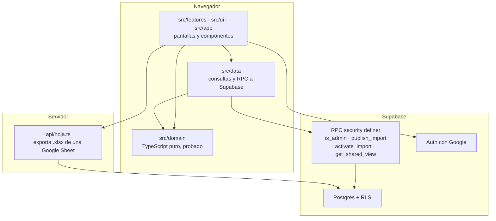
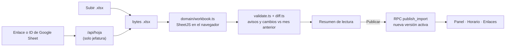

# Visión general de la arquitectura

Dónde vive cada cosa y por qué. Fuente: plan §4 y §6.2.

## Las capas

**La regla que lo ordena todo:** las flechas no suben. `src/domain` no sabe que existen React,
Supabase ni las pantallas; `src/data` no contiene reglas de negocio; las pantallas no hablan con
Postgres directamente. El linter lo hace cumplir con `no-restricted-imports` sobre `src/domain/**`.

## Qué hay en cada carpeta

| Carpeta | Responsabilidad | Qué **no** va aquí |
|---|---|---|
| `src/domain/` | Las reglas: interpretar una celda, normalizar nombres, resolver el catálogo, leer el libro, mezclar la hoja con los cambios, calcular presencia y conflictos, resolver el alcance de un enlace. TypeScript puro, 100 % con pruebas | React, Supabase, `fetch`, `localStorage` |
| `src/data/` | Acceso a Supabase: consultas y llamadas a RPC | Reglas de negocio, cálculos |
| `src/features/` | Una carpeta por pantalla: `empleado`, `fuente`, `panel`, `horario`, `compartir` | Lógica reutilizable (va a `domain`) |
| `src/ui/` | Componentes base y `tokens.css` | Nada específico de una pantalla |
| `src/app/` | Rutas, sesión y layouts | — |
| `api/` | Funciones de Vercel. Hoy solo `hoja.ts` | Cualquier cosa que el navegador pueda hacer solo |
| `supabase/migrations/` | Esquema, RLS y RPC. Una migración por cambio | — |

Cada archivo de `src/domain/` y `src/features/` empieza con un comentario de 2–3 líneas: qué hace y
qué ficha de `docs/` lo describe. `npm run docs:check` lo verifica.

## El flujo de los datos

Tres cosas que explican casi todo el diseño:

1. **El `.xlsx` se parsea en el navegador**, nunca en el servidor. El archivo no se guarda en ningún
   sitio ([ADR-0004](../adr/0004-un-solo-camino-de-lectura.md)).
2. **Publicar crea una versión**, no sobrescribe. Cada mes apunta a su versión activa y se puede
   volver atrás ([ADR-0010](../adr/0010-versiones-de-importacion.md)).
3. **Lo que se muestra es el horario efectivo**: la hoja más los cambios de jefatura, mezclados al
   leer por `overlay.ts` ([ADR-0003](../adr/0003-cambios-como-capa.md)).

## Entornos

| Entorno | Sitio | Base de datos |
|---|---|---|
| Local | `npm run dev` | proyecto Supabase de desarrollo |
| *Preview* | Vercel, uno por PR | proyecto Supabase de desarrollo |
| *Production* | Vercel, desde `main` | proyecto Supabase de producción |

Detalles en [../operacion/despliegue.md](../operacion/despliegue.md).

## Decisiones que lo sustentan

[ADR-0002](../adr/0002-stack.md) (stack) · [ADR-0003](../adr/0003-cambios-como-capa.md) (capa de
cambios) · [ADR-0004](../adr/0004-un-solo-camino-de-lectura.md) (un solo parser) ·
[ADR-0007](../adr/0007-conflictos-como-funciones-puras.md) (conflictos puros) ·
[ADR-0008](../adr/0008-tiempo-fechas-locales-y-minutos.md) (tiempo) ·
[ADR-0010](../adr/0010-versiones-de-importacion.md) (versiones).
