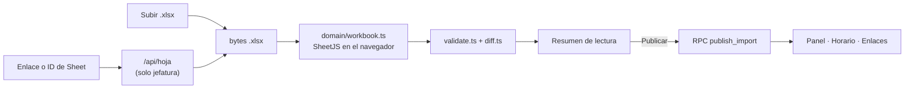

# Carga del horario

**Qué hace (para el usuario):** jefatura trae el horario del mes —subiendo un Excel o pegando el
enlace de una Google Sheet—, revisa un resumen de lo que se leyó y lo publica. A partir de ahí es lo
que ven el panel, el horario completo y los enlaces de empleado.

**Dónde:** `/jefe/fuente` · capturas de referencia `06-jefe-fuente-google-sheet.png` y
`07-jefe-fuente-excel.png`

> **Estado: especificado, sin implementar.** El dominio llega en la **Fase 1**; la pantalla y la
> publicación en la **Fase 2**. Esta ficha se actualiza en el mismo PR que el código.

## Cómo funciona

**Todo entra como `.xlsx` y pasa por el mismo parser**
([ADR-0004](../adr/0004-un-solo-camino-de-lectura.md)). El archivo se parsea en el navegador y no se
guarda en ningún sitio.

## Archivos

| Archivo | Responsabilidad |
|---|---|
| `src/domain/time.ts` | `DateKey`, minutos desde medianoche, semana que empieza en lunes |
| `src/domain/shift.ts` | Interpretar una celda y su categoría de color |
| `src/domain/names.ts` | Clave estable de persona y nombre a mostrar |
| `src/domain/catalog.ts` | Departamento → rol, sede, área |
| `src/domain/workbook.ts` | Libro de SheetJS → meses → personas → días |
| `src/domain/validate.ts` | Avisos de importación |
| `src/domain/diff.ts` | Cambios contra el mes anterior |
| `src/data/imports.ts` | Llamadas a `publish_import` y `activate_import` |
| `src/features/fuente/` | La pantalla |
| `api/hoja.ts` | Exporta el `.xlsx` de una Google Sheet (solo jefatura) |

## Datos

| Qué | Cómo |
|---|---|
| Escribe | `imports`, `people` (upsert por `key`), `schedule_entries`, `month_versions` — todo dentro de la RPC `publish_import`, en **una transacción**, solo admin |
| Lee | `month_versions` e `imports` para el historial y la versión activa |

Ver [../arquitectura/modelo-de-datos.md](../arquitectura/modelo-de-datos.md).

## Reglas y parámetros

- Formato de la hoja e interpretación de celdas:
  [../datos/formato-hoja.md](../datos/formato-hoja.md).
- Catálogo de departamentos: [../datos/catalogo-departamentos.md](../datos/catalogo-departamentos.md).
- **Clave estable de persona:** quitar el sufijo `(d/m)` (es la fecha de ingreso, con el año de la
  pestaña), quitar comas, normalizar y **ordenar los tokens alfabéticamente**. Así la misma persona
  se reconoce entre meses aunque el nombre venga escrito de otra forma.
- **Nombre a mostrar:** siempre «nombres + apellidos». Si viene `APELLIDOS, NOMBRES` se invierte; si
  viene en mayúsculas se agrupan las partículas (`DE`, `DEL`, `DE LA`, `DE LOS`, `LA`, `LAS`, `Y`)
  con la palabra siguiente y se reparten los grupos (2 grupos → 1 apellido + 1 nombre; 3 → 1 + 2;
  4 → 2 + 2; 5 o más → 2 apellidos + el resto). Las correcciones manuales de jefatura se guardan
  como `display_name_source='manual'` y se respetan en las importaciones siguientes.
- **`content_hash`:** si el libro es idéntico al activo, no se publica.
- **Versiones:** publicar crea una versión y se puede volver atrás
  ([ADR-0010](../adr/0010-versiones-de-importacion.md)).

## Errores y mensajes

| Situación | Mensaje exacto | Qué hacer |
|---|---|---|
| Hoja de Google privada (`403 HOJA_PRIVADA`) | «La hoja pide iniciar sesión. Pide a coordinación compartirla como "Cualquier persona con el enlace · Lector", o sube el Excel.» | Subir el Excel, o pedir el cambio de permiso |
| ID de hoja inválido | Se rechaza **antes** de llamar a `/api/hoja` | Revisar el enlace |
| El libro es idéntico al activo | «No hay cambios desde la última carga» | Nada: es correcto |
| Pestaña que no encaja con el formato | Va a `skipped` como aviso | Revisar la fila 2 de esa pestaña |
| Celda vacía o no reconocida | Aviso de importación; **no** rompe la carga | Revisar con coordinación |

## Pruebas

- `tests/domain/` — fixtures **sintéticos** construidos con SheetJS: pestaña oculta; fechas desde la
  columna D; columna de fórmula al final; `CONTACTOS`; `VACACIONES`; celda vacía y desconocida;
  `(3/11)`; nombre con coma; nombre ya en orden; turno nocturno y `15:00-00:00`; departamento mal
  escrito y desconocido; persona que cambia de departamento entre meses.
- `tests/local/` — conteos y casos de control con el libro real. **Se salta** si no existe
  `referencias/privado/`.
- Cobertura de `src/domain` ≥ 90 % de líneas.

## Decisiones

[ADR-0004](../adr/0004-un-solo-camino-de-lectura.md) ·
[ADR-0005](../adr/0005-acceso-a-google-sheet.md) (**Propuesto**) ·
[ADR-0008](../adr/0008-tiempo-fechas-locales-y-minutos.md) ·
[ADR-0009](../adr/0009-catalogo-en-codigo.md) ·
[ADR-0010](../adr/0010-versiones-de-importacion.md)

## Origen

Se reescribe desde cero tomando ideas de v1 (`referencias/legado/`), sin copiar archivos
([ADR-0001](../adr/0001-repo-nuevo.md)):

| Archivo de v1 | Idea que se toma | Qué cambia en v2 |
|---|---|---|
| `src/lib/parser.ts` · `coerceSheetDate` | Aceptar `Date`, serial de Excel, `YYYY-MM-DD` y `dd/mm/yyyy` | Devuelve `DateKey` (texto), no `Date` |
| `parser.ts` · `parseWorkbookAll` | `sheet_to_json(header:1, raw:true)`; emparejar columna con su fecha de la fila 2; las hojas que no encajan van a `skipped` | Detecta pestañas ocultas. Devuelve **todas** las personas con departamento, rol y sede |
| `parser.ts` · `parseShiftValue` | Regex de turno con espacios opcionales, `Libre`, `VACAC` | `00:00` no cruza; `unknown` siempre avisa |
| `parser.ts` · `isIgnoredSheetName` | `CONTACTOS` y prefijo `_` | Igual |
| `src/lib/utils.ts` | `normalize`, `toKey` | La clave de persona usa tokens ordenados |
| `src/lib/location.ts` | Expresiones de sede y rol | Tabla explícita primero; 10 roles, 7 sedes, área y «Sin sede» |

**Deuda de v1 que esto resuelve:** no leía Google Sheets, los cambios vivían en un solo navegador,
el login era simulado y no había pruebas.

## Pendiente / Próximamente

- Leer la Sheet con la cuenta de Google de jefatura.
- Revisión automática cada 15 min / cada hora (necesita un cron y su propio ADR).
