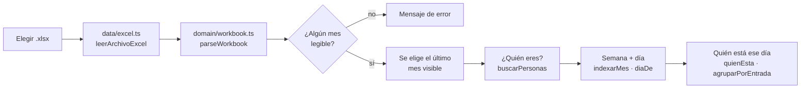

# Demo local de la vista de empleado

**Qué hace (para el usuario):** sube un `.xlsx` del horario y, sin ninguna cuenta ni servidor,
busca su nombre, ve su semana, su día y quién más está trabajando ese día. Todo ocurre en el
navegador; nada se guarda ni se envía a ningún sitio.

**Dónde:** se monta como la pantalla raíz de la aplicación (`App.tsx`) mientras la demo esté activa.
Sin captura de referencia propia: reutiliza la idea de las capturas 01–04 del plan
(`referencias/diseno/capturas/01-empleado-mi-dia.png` y siguientes), simplificada.

> **Esta pantalla es desechable.** Existe para validar el dominio y los nombres con jefatura antes de
> construir la infraestructura de la Fase 2. La Fase 3 construye la vista de empleado real —con
> enlaces, alcance y fidelidad visual completa— y en ese momento `src/features/demo/` se retira.
> Decisión: [ADR-0014](../adr/0014-demo-local-antes-de-fase-2.md) (**Propuesto**).

## Cómo funciona

Tres estados en `Demo.tsx`: `vacio` (esperando archivo), `cargando`, `error` y `listo`. Dentro de
`listo`, `VistaEmpleado.tsx` tiene su propio estado interno: sin persona elegida (buscador) o con
persona elegida (semana, día, quién está).

`mostrandoKey` es distinto de `personaKey`: al tocar una fila de «quién está ese día» se puede mirar
el horario de otra persona sin perder la propia; «Volver a mi horario» recupera `personaKey`.

## Archivos

| Archivo | Responsabilidad |
|---|---|
| `src/features/demo/Demo.tsx` | Carga del archivo, selector de mes, resumen de avisos |
| `src/features/demo/VistaEmpleado.tsx` | Buscador, semana, tarjeta del día, «quién está ese día» |
| `src/data/excel.ts` | Lee el `.xlsx` con SheetJS. Reutilizado tal cual por la Fase 2 |
| `src/domain/presence.ts` | `indexarMes`, `diaDe`, `quienEsta`, `agruparPorEntrada`, `buscarPersonas`, `resumirSemana`. Adelantado de la Fase 3 porque esta demo lo necesita |

## Datos

Ninguno persiste. El archivo se lee con `file.arrayBuffer()` y vive solo en el estado de React
mientras la pestaña está abierta.

## Reglas y parámetros

Las mismas del dominio: interpretación de celdas (`shift.ts`), catálogo de departamentos
(`catalog.ts`), nombres (`names.ts`). Ver docs/datos/.

Simplificaciones **a propósito** frente al plan §7.1 (documentadas en el ADR, no requieren ADR
propio por ser de la demo):

- Sin «Pasar a Google Calendar», avisos ni cronómetro: son Próximamente en el producto real y no
  tienen sentido en una demo sin cuenta.
- Sin el punto naranja de «cambio hecho por jefatura»: no hay `day_overrides` sin base de datos.
- Sin `localStorage`: la persona elegida se pierde al recargar la página.
- Los textos no son pixel-perfect al mockup; sí se usan literales donde coinciden: «¿Quién eres?»,
  «Tu semana», «Quién está ese día», «Soy esta persona», «Volver a mi horario», «Mismo horario»,
  «Mi equipo», «Toda la operación», «Libre», «Vacaciones», «Sin datos».

## Errores y mensajes

| Situación | Mensaje | Qué hacer |
|---|---|---|
| Archivo > 10 MB | El mensaje de `ExcelDemasiadoGrande` | Elegir un archivo más pequeño |
| Archivo no es un `.xlsx` válido | El mensaje de `ExcelIlegible` | Comprobar el archivo |
| Ningún mes legible | «No se encontró ningún mes legible…» | Revisar que la fila 2 tenga fechas |
| Nadie coincide con la búsqueda | «Sin resultados.» | — |
| Nadie cumple el alcance elegido | «Nadie en este alcance.» | — |

## Pruebas

Ninguna automatizada: es UI de usar y tirar, no lógica de dominio (que sí está probada en
`tests/domain/presence.test.ts`, 29 casos). Se verificó a mano:

1. `npm run dev`, subir `tests/fixtures/horario-anon.xlsx` (datos ficticios).
2. El libro carga Noviembre por defecto (el último mes visible) y muestra el conteo de avisos.
3. Buscar «an» devuelve hasta 6 personas con rol, sede y departamento.
4. «Soy esta persona» abre la semana; un día con turno `15:00-00:00` se muestra **sin** «termina al
   día siguiente» (confirma el ADR-0008 en pantalla); un día `Libre` deshabilita el chip «Mismo
   horario» y lo muestra atenuado.
5. «Quién está ese día» lista personas reales del fixture, agrupadas por hora de entrada; tocar una
   fila cambia la vista a esa persona y aparece «Volver a mi horario», que al pulsarlo regresa a la
   persona original.
6. Cambiar de mes en el selector reinicia la búsqueda y la semana (el componente se remonta con
   `key={mes.sheetName}`).

## Decisiones

[ADR-0014](../adr/0014-demo-local-antes-de-fase-2.md) (Propuesto).

## Origen

No viene de un mockup ni de v1: es una pantalla nueva, pedida directamente por Ado para esta sesión.

## Pendiente / Próximamente

Todo lo que trae la Fase 3 real: enlaces de solo lectura, alcance, vencimiento, móvil 390 px sin
scroll horizontal, fidelidad visual a las capturas 01–04, y el bloque «Próximamente» del plan §7.7.
