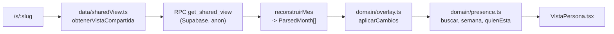

# Vista de empleado

**Qué hace (para el usuario):** cualquiera con el enlace de la operación (`/s/:slug`, sin cuenta)
escribe su nombre, ve su semana y el detalle del día seleccionado — incluido un cambio hecho por
jefatura, si lo hay — y quién más está trabajando ese día en tres alcances: mismo horario, su
equipo, o toda la operación. Es el **primer entregable usable** del plan (Fase 3).

**Dónde:** `/s/:slug` · capturas de referencia `01-empleado-mi-dia.png` a `05-empleado-movil.png`.

## Cómo funciona

`Empleado.tsx` resuelve el estado de la carga antes de pintar nada más: **cargando** (esqueleto),
**inactivo** (enlace vencido/revocado/inexistente — mismo mensaje para los tres, a propósito),
**alcance-no-disponible** (un alcance que todavía no existe, como `semana` o `dia` antes de la Fase
7), **error** (falló la red), u **ok** con la `VistaCompartida` ya lista para `VistaPersona`.

## Archivos

| Archivo | Responsabilidad |
|---|---|
| `src/features/empleado/Empleado.tsx` | Punto de entrada de `/s/:slug`: pide la vista, resuelve el estado |
| `src/features/empleado/VistaPersona.tsx` | La pantalla: buscador, semana, tarjeta del día, quién está ese día |
| `src/features/empleado/almacenPersona.ts` | Recuerda la última persona vista, por slug, en `localStorage` |
| `src/features/empleado/empleado.css` | Grid de la semana y el toggle escritorio/móvil a 560 px |
| `src/data/sharedView.ts` | Llama `get_shared_view` y reconstruye `ParsedMonth[]` / `DayOverride[]` |
| `src/data/shareLinks.ts` | Crear, consultar y revocar el enlace de la operación (usado desde Fuente) |
| `src/domain/overlay.ts` | Mezcla la hoja con los cambios de jefatura: el «horario efectivo» (ADR-0003) |
| `src/domain/share.ts` | Slug aleatorio, vencimiento, si un enlace sigue vigente |
| `src/domain/presence.ts` | Reutilizado tal cual de la Fase 1: buscador, semana, «quién está ese día» |
| `src/ui/colorRol.ts` | Colores por rol y por categoría de turno (mañana/tarde/noche), para los chips |
| `src/features/fuente/EnlaceOperacion.tsx` | Botón mínimo en Fuente de datos: crear/copiar/revocar el enlace |
| `supabase/migrations/20261104180132_get_shared_view.sql` | La única función que `anon` puede llamar |

## Datos

`get_shared_view(p_slug)` es **el único camino de lectura pública** (ADR-0004): valida el slug,
actualiza `last_opened_at`, y arma un jsonb con `scope`, `title`, `source` (de dónde viene la hoja
activa), `months[]` (uno por `month_versions`, cada uno con sus `dates`/`people`/`entries`) y
`overrides[]` (todo `day_override` vigente, **nunca** `created_by`/`revoked_by` — plan §5.6). La
llaman tanto `anon` como `authenticated`: la función no distingue quién pregunta, todo el control
está en el slug (ver más abajo).

`src/data/sharedView.ts` reconstruye cada mes crudo a `ParsedMonth` con `resolveDepartment()` del
catálogo (nunca con un rol/sede que viniera de la base). El departamento que se muestra junto al
nombre de una persona es el de **la primera entrada que trae ese mes** para su clave — si cambió de
departamento a mitad de mes, cuál de las dos department apareció primero depende del orden del
`jsonb_agg` en el servidor, no está garantizado que sea la más reciente (ver Pendiente).

## Reglas y parámetros

- **Horario efectivo (ADR-0003):** `domain/overlay.ts` nunca modifica `schedule_entries`; construye,
  a partir de la hoja + los `day_overrides` vigentes, lo que ve el empleado. Un cambio solo puede
  traer una `site` distinta, nunca un `department` nuevo — ese se conserva siempre de la hoja.
- **Multi-mes sin cortes:** `combinarMeses()` junta todos los meses de la vista en uno solo para que
  la navegación de semana no se corte en el límite de un mes (p. ej. una semana que empieza en
  octubre y termina en noviembre).
- **Vencimiento del enlace (plan §7.6):** solo `fin-de-mes` en esta fase (`24h`/`7d` ya existen en
  `domain/share.ts` para la Fase 7). `calcularVencimiento('fin-de-mes')` es el primer instante del
  mes siguiente, hora local de quien crea el enlace — un instante real, no un día de negocio
  (ADR-0008 no aplica aquí).
- **Slug:** `prefijo-` + 12 caracteres base62 de `crypto.getRandomValues` (`domain/share.ts`), no el
  hash corto del mockup (diferencia aceptada §7.8-5 de `diseno/pantallas.md`).
- **«Quién está ese día» con persona duplicada:** si la hoja trae dos filas para la misma persona
  (aviso `persona-duplicada` del dominio), ambas aparecen en la lista; la `key` de React combina la
  clave de persona con la posición para no chocar.

## Errores y mensajes

| Situación | Mensaje | Por qué |
|---|---|---|
| Slug que no existe, vencido o revocado | «Este enlace ya no está activo. Pide uno nuevo a jefatura.» | Mismo mensaje para los tres: no da pistas a quien prueba slugs al azar |
| Alcance que no sea `operacion` | «Este enlace todavía no está disponible. Pide uno nuevo a jefatura.» | `semana`/`dia`/`persona`/`cambio` llegan en la Fase 7 |
| Falla la red/RPC | «No se pudo cargar el horario. Vuelve a intentarlo.» | — |

## Pruebas

- `tests/domain/overlay.test.ts` (10 casos): un cambio reemplaza el turno pero conserva el
  departamento; sin cambio, la entrada original; `tieneCambio` para el punto naranja.
- `tests/domain/share.test.ts` (10 casos): slug con el prefijo y largo esperados, las tres opciones
  de vencimiento, un enlace revocado nunca está vigente aunque no haya vencido.
- `tests/db/get_shared_view.test.ts` (11 casos, `npm run test:db`): slug inválido/vencido/revocado
  dan `ENLACE_INACTIVO`; `anon` no puede leer `share_links` directo; un alcance que no sea
  `operacion` da `ALCANCE_NO_DISPONIBLE`; un cambio de jefatura vigente aparece sin exponer quién lo
  hizo, uno revocado no aparece; **un usuario con sesión también puede llamar la función, no solo
  `anon`** (ver «Bug real encontrado» abajo); **un import que cubre dos meses no mezcla las entradas
  de un mes con las del otro** (regresión del mismo bug).

### Bug real encontrado probando en el navegador, no solo con pruebas automáticas

Con el fixture anonimizado real (un solo import que cubre octubre **y** noviembre — así viene la
hoja real, dos pestañas en el mismo archivo), «Toda la operación» del 5 de noviembre mostraba
**166** personas en vez de las ~103 esperadas, y una persona mostraba un departamento distinto en la
cabecera («CC N1») y en la tarjeta del día («CC N2») para el mismo día.

Confirmado por `psql` directo que la base estaba limpia (ninguna persona con filas duplicadas en
`schedule_entries`, ningún nombre colisionando en `people`), así que el problema no podía ser de
datos. Inspeccionando el jsonb crudo que devuelve `get_shared_view`: **los bloques de octubre y
noviembre traían exactamente las mismas 6128 entradas, 104 personas y 61 fechas cada uno** — el
import entero, duplicado en los dos meses.

Causa: la función filtraba `entries`/`people`/`dates` de cada mes **solo por `import_id`**, nunca
por fecha. Un import que cubre dos meses calendario tiene **dos filas en `month_versions`** (una por
mes) que comparten el mismo `import_id` — así que cada bloque de mes devolvía el import completo, no
solo su propio mes. Eso también explicaba el departamento inconsistente: `reconstruirMes()` toma el
departamento de la *primera* entrada que encuentra para esa persona en el mes, y con los dos meses
mezclados esa «primera entrada» podía venir del mes equivocado.

Arreglo en `supabase/migrations/20261104180132_get_shared_view.sql`: las tres subconsultas ahora
también filtran `se.date >= mv.month and se.date < (mv.month + interval '1 month')`. Verificado con
`npm run test:db` (el nuevo caso de regresión) y de nuevo en el navegador con el fixture real: el
conteo bajó de 166 a **83** (justo la mitad, como predice una duplicación exacta) y el departamento
de la cabecera ya coincide con el de la tarjeta del día.

- **Probado a mano en el navegador** con el fixture anonimizado real: sesión de admin inyectada,
  publicar octubre+noviembre desde un solo archivo, crear el enlace desde Fuente, abrirlo en otra
  pestaña, buscar una persona, navegar entre semanas que cruzan el límite de mes, ver «Quién está ese
  día» en los tres alcances, «Volver a mi horario» después de tocar a otra persona en la lista, y un
  enlace recién revocado mostrando el mensaje de inactivo al recargar. Sin errores ni warnings en
  consola (incluida la advertencia de `key` duplicada del caso `persona-duplicada`, ya corregida).

## Decisiones

[ADR-0003](../adr/0003-cambios-como-capa.md) · [ADR-0004](../adr/0004-un-solo-camino-de-lectura.md) ·
[ADR-0006](../adr/0006-acceso-de-empleados-y-jefatura.md) · [ADR-0008](../adr/0008-tiempo-fechas-locales-y-minutos.md)

## Origen

Reescrito desde cero; la lectura de la hoja y «quién está ese día» vienen tal cual de
`domain/presence.ts` (construido en la Fase 1 para la demo local, ADR-0014). La pantalla sigue la
estructura de `Empleado.dc.html`; los textos «¿Quién eres?», «Tu semana», «Quién está ese día»,
«Mismo horario» / «Mi equipo» / «Toda la operación», «Volver a mi horario» son literales del mockup.

## Pendiente / Próximamente

- **390 px sin scroll horizontal:** el CSS sigue la regla del plan §7.8-3 (tira semanal con un punto
  de color en vez del rango completo), pero falta la comparación pixel a pixel contra
  `05-empleado-movil.png` en un viewport real — quedó pendiente de esta sesión por no poder
  redimensionar la ventana del navegador compartida con el resto del escritorio.
- El departamento mostrado junto al nombre de una persona (fuera de la tarjeta del día) es «el de la
  primera entrada del mes», no necesariamente el más reciente si cambió a mitad de mes. No es el bug
  de arriba — es una simplificación que queda para cuando haga falta mostrar department vigente
  «a hoy» en otro lugar de la interfaz.
- «Pasar a Google Calendar», «Avisos para marcar», «Cronómetro de horas» y «Vista de mes»: cajas
  «Próximamente», sin lógica (plan §7.1).
- Los alcances `semana`, `dia`, `persona`, `cambio` de `share_links` (Fase 7).
