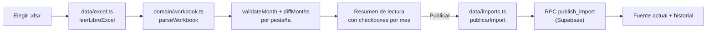

# Fuente de datos

**Qué hace (para el usuario):** jefatura sube el Excel del mes, revisa cuántas personas,
departamentos y sedes trae cada pestaña, ve qué cambió contra el mes anterior, y publica. Puede
volver a cualquier versión anterior de un mes desde el historial.

**Dónde:** `/jefe/fuente` · capturas de referencia `06-jefe-fuente-google-sheet.png` y
`07-jefe-fuente-excel.png`.

## Cómo funciona

El acceso pasa primero por `app/RutaJefatura.tsx`: sin sesión pide «Entrar con Google»; con sesión
pero sin acceso muestra «No tienes acceso de jefatura»; con acceso pinta el menú y esta pantalla.

## Archivos

| Archivo | Responsabilidad |
|---|---|
| `src/features/fuente/Fuente.tsx` | La pantalla: subir, resumen, publicar, historial |
| `src/app/RutaJefatura.tsx` | Guardián de sesión + layout con menú lateral |
| `src/app/useSesion.ts` | Estado de la sesión: cargando / sin sesión / sin acceso / jefatura |
| `src/data/auth.ts` | `iniciarSesionConGoogle`, `cerrarSesion`, `esAdmin` |
| `src/data/imports.ts` | Arma el payload de `publish_import` y consulta el historial |
| `src/data/content-hash.ts` | SHA-256 del archivo, para que el servidor detecte si no cambió |
| `src/data/supabase.ts` | El cliente de Supabase del navegador |
| `api/hoja.ts` | Exporta el `.xlsx` de una Google Sheet (ADR-0005, **Propuesto**) |
| `supabase/migrations/20261104172348_esquema_inicial.sql` | Esquema, RLS, `is_admin`, `publish_import`, `activate_import` |

## Datos

Lee y escribe a través de las RPC `publish_import` y `activate_import`
(docs/arquitectura/modelo-de-datos.md). Lee directo `month_versions` e `imports` para «Fuente
actual» y el historial — eso lo permite la política RLS porque quien pregunta ya es admin.

## Reglas y parámetros

- **`content_hash`:** si el mismo contenido ya es la versión activa de todos los meses
  seleccionados, `publish_import` rechaza con `SIN_CAMBIOS` y la pantalla muestra «No hay cambios
  desde la última carga» (ADR-0010).
- **Selección de meses:** por defecto se marcan los meses **no ocultos**; una pestaña oculta en la
  hoja (como Septiembre) se puede seleccionar a mano si hace falta.
- **Diff contra el mes anterior:** se calcula **dentro del mismo archivo subido** (si Octubre y
  Noviembre vienen en el mismo libro, se comparan entre sí). No compara contra lo que ya está en la
  base: es una simplificación de la Fase 2, documentada aquí en vez de en un ADR porque no cambia
  ningún dato, solo qué tan completo es el resumen que se muestra antes de publicar.
- **`display_name` manual:** si jefatura corrigió el nombre de una persona, la siguiente carga no lo
  pisa (`display_name_source = 'manual'`), verificado en `tests/db/publish_import.test.ts`.

## Errores y mensajes

| Situación | Mensaje | Qué hacer |
|---|---|---|
| Archivo > 10 MB | El de `ExcelDemasiadoGrande` | Elegir un archivo más pequeño |
| Archivo no es un `.xlsx` válido | El de `ExcelIlegible` | Comprobar el archivo |
| Ningún mes legible | «No se encontró ningún mes legible en el archivo.» | Revisar la fila 2 |
| Mismo contenido ya publicado | «No hay cambios desde la última carga.» | Nada: es correcto |
| Sin sesión | «Entra con tu cuenta de Google…» | Pulsar «Entrar con Google» |
| Con sesión, sin acceso | «No tienes acceso de jefatura» + el correo | Pedir que agreguen el correo a `admins` |

## Pruebas

- `tests/db/rls.test.ts` (16 casos): `anon` no lee ni escribe ninguna tabla; `is_admin()` distingue
  correctamente; `publish_import` solo lo puede llamar un admin.
- `tests/db/publish_import.test.ts` (5 casos): crea personas y entradas, `content_hash` evita
  publicar dos veces lo mismo, respeta `display_name` manual, `activate_import` cambia la versión
  activa y rechaza un mes que el import no cubre.
- Corren contra un stack local de Supabase (`npm run test:db`, requiere `supabase start`); fuera del
  CI por la misma razón que `tests/local/` (plan §11).
- **Probado a mano en el navegador** con el fixture anonimizado: carga de las 3 pestañas con los
  conteos reales (103/26/8 en Noviembre, 98/31 en Octubre), diff mostrando «12 cambios de
  departamento y 1 salida» (coincide con el caso de control del plan §7.3), publicar, «Volver a esta
  versión» cambiando la versión activa del mes sin tocar los demás, y la pantalla de «No tienes
  acceso» bloqueando a un usuario autenticado que no está en `admins`.

## Decisiones

[ADR-0004](../adr/0004-un-solo-camino-de-lectura.md) ·
[ADR-0005](../adr/0005-acceso-a-google-sheet.md) (**Propuesto**) ·
[ADR-0006](../adr/0006-acceso-de-empleados-y-jefatura.md) ·
[ADR-0010](../adr/0010-versiones-de-importacion.md) ·
[ADR-0015](../adr/0015-enrutador.md)

## Origen

Reescrito desde cero sobre la idea de `src/lib/share.ts` y las migraciones de v1 (patrón RLS sin
lectura directa + RPC `security definer`), citado en el plan §6.1. La pantalla sigue la estructura de
`Fuente.dc.html`; los textos «Fuente actual», «Subir Excel (.xlsx)», «Enlace o ID de Google Sheets»,
«Cómo debe venir la hoja» son literales del mockup.

## Pendiente / Próximamente

- La pestaña «Enlace o ID de Google Sheets» (ADR-0005, bloqueada por la pregunta abierta §13-1).
- «Revisar ahora» con frecuencia automática.
- Fidelidad visual completa a las capturas 06–07 (hoy la pantalla es funcional pero no
  pixel-perfect; se ajusta en una pasada de pulido).
- El diff contra el mes anterior cuando ese mes no viene en el mismo archivo subido.
