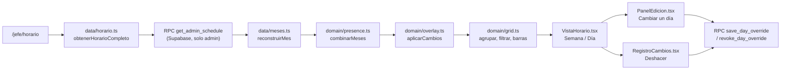

# Horario completo

**Qué hace (para el usuario):** jefatura ve el horario de toda la operación en una grilla semanal
(nombre fijo, un día por columna) o en una línea de tiempo por día, agrupado por departamento, con
filtros de nombre/sede/rol. Toca un nombre para ver la semana de esa persona. Toca una celda (o
«Editar») para cambiar ese día: turno, libre o vacaciones, sede, apoyo, motivo y nota. El cambio se
guarda como capa encima de la hoja (ADR-0003) y se puede deshacer desde el registro «Cambios · n».
Los botones «Compartir» abren la pantalla de la Fase 7 con semana/filtros, persona o cambio
precargados (ADR-0016, actualizado).

**Dónde:** `/jefe/horario` · capturas `10`, `11`–`14`, `17` y `18`.

## Cómo funciona

`Horario.tsx` resuelve cargando/error antes de pintar `VistaHorario.tsx`, igual que `Empleado.tsx`
en la Fase 3.

## Archivos

| Archivo | Responsabilidad |
|---|---|
| `src/features/horario/Horario.tsx` | Punto de entrada: pide el horario, resuelve el estado |
| `src/features/horario/VistaHorario.tsx` | La pantalla: filtros, vista Semana, vista Día, vista rápida, aviso verde |
| `src/features/horario/PanelEdicion.tsx` | Panel «Cambiar un día» (plan §7.5) |
| `src/features/horario/RegistroCambios.tsx` | Registro «Cambios de jefatura · n» y «Deshacer» |
| `src/features/horario/horario.css` | Grid, columna de nombre fija, línea de tiempo 00–24 y la columna «Editar» de la vista Día |
| `src/app/jefatura.css` | Menú lateral en escritorio; barra superior bajo 700 px para que el E2E de 390 px no tape la grilla |
| `src/data/horario.ts` | `get_admin_schedule`, `guardarCambioDia` y `deshacerCambioDia` |
| `src/data/meses.ts` | Reconstrucción jsonb → dominio, compartida con `sharedView.ts` (Fase 3) |
| `src/domain/edicion.ts` | Horarios frecuentes, avisos de descanso y compañeros/apoyo |
| `src/domain/grid.ts` | Agrupar por departamento, filtrar, posición de las barras de la vista Día |
| `src/domain/presence.ts` | `combinarMeses` (compartido con la vista de empleado), índice, semana |
| `src/domain/overlay.ts` | El horario efectivo: hoja + cambios de jefatura (Fase 3) |
| `supabase/migrations/20261104190000_get_admin_schedule.sql` | RPC interna, solo `is_admin()` |
| `supabase/migrations/20261104200000_cambiar_un_dia.sql` | `save_day_override` y `revoke_day_override` |

## Datos

`get_admin_schedule()` no recibe parámetros ni pasa por `share_links`: solo comprueba `is_admin()` y
devuelve `months`/`overrides` con la misma forma que `get_shared_view` (Fase 3), reutilizando el
mismo patrón de filtrar cada mes también por fecha dentro de `month_versions.month`, no solo por
`import_id` — ver «Bug real» en `docs/features/empleado.md` para el porqué. `src/data/meses.ts` saca
esa reconstrucción de `sharedView.ts` a un módulo compartido para que `horario.ts` no la duplique.

## Reglas y parámetros

- **Meses combinados, no un selector de mes (ADR-0016):** igual que la vista de empleado,
  `combinarMeses` junta todos los meses activos para que una semana que cruza de un mes a otro (p.
  ej. 30 nov – 6 dic) no se corte. Verificado a mano: el 30 de noviembre muestra datos reales y el 1
  de diciembre «Sin datos» sin romper nada, cuando diciembre todavía no está publicado.
- **Agrupar por departamento, no por rol:** dos departamentos pueden compartir rol (`MEGA N1` y
  `CC N1` son ambos `N1`), así que el grupo es el departamento tal como viene en la hoja
  (`domain/grid.ts`, `agruparPorDepartamento`). Orden alfabético, todos los grupos abiertos por
  defecto (ADR-0016, punto 3).
- **Vista Semana:** celda coloreada por categoría del turno (mañana/tarde/noche), con el punto y el
  borde punteado naranja si ese día tiene un cambio de jefatura vigente (`tieneCambio`, reutilizado
  de `domain/overlay.ts`). Total de horas y turnos por persona con `resumirSemana` (Fase 1). En
  390 px el menú de jefatura pasa a una barra superior (`src/app/jefatura.css`) para que la columna
  de nombre fija no cubra las celdas ni «Editar»; la tabla sigue con scroll horizontal, como pide
  el plan §7.8-3.
- **Vista Día:** línea de tiempo 00–24 por persona. Un turno que cruza medianoche se recorta a la
  medianoche (`barraDeHoy`); la parte que viene de un turno de **ayer** que cruzó aparece como barra
  punteada desde las 00:00 (`barraDeAyer`), con el texto «hasta HH:MM (de ayer)». Quien solo tiene
  esa barra punteada (su turno real de hoy es Libre) sigue apareciendo en la lista de «en turno», no
  en el texto de libres — igual que el mockup.
- **Cambiar un día (plan §7.5).** El panel se abre desde una celda de la vista Semana, desde
  «Editar» en la vista Día o desde «Editar {día}» en la vista rápida. Muestra el valor de la hoja y
  precarga el valor efectivo. Con Turno: hasta 6 horarios rápidos, los más frecuentes del
  departamento en los meses cargados (`turnosFrecuentes`). Sede del día (la habitual marcada
  «(su sede)»). Compañeros con el mismo horario exacto y, por solape, hasta 8 candidatos de apoyo
  (`companerosYApoyo`), respetando la sede efectiva de cada persona ese día. Motivo obligatorio (las
  6 opciones del mockup) y nota opcional. «Guardar cambio» queda deshabilitado sin motivo o sin
  horas válidas. Si el día ya tiene un cambio, aparecen «Volver a lo de la hoja» y, al reabrir, el
  motivo, la nota y el apoyo que se guardaron.
- **Avisos de descanso: avisan, no bloquean.** Menos de 8 h respecto al turno de ayer o de mañana, o
  un turno de más de 12 h (`DESCANSO_MINIMO_MIN` y `TURNO_MAXIMO_MIN` en `domain/edicion.ts`). Son
  los valores **Propuestos** del bloqueo §2 de `docs/progreso.md`: el plan §7.5 ya los usa en esta
  pantalla. No están confirmados y no se marcan como Aceptados.
- **Guardar y deshacer.** `save_day_override` revoca el vigente de esa persona y fecha e inserta el
  nuevo en la misma transacción (el índice único no permite dos vigentes). Desde el panel, el mismo
  cambio puede llevar `conflict_key` (la migración `20261104210000_panel_conflictos.sql` reemplaza
  la función). Desde esta pantalla el campo va vacío. `revoke_day_override` lo
  usa tanto «Volver a lo de la hoja» como «Deshacer» del registro, y no falla si ya no hay nada que
  revocar. Tras guardar, un aviso verde con el texto literal del plan y la grilla vuelve a pedirse
  sin pasar por el esqueleto de carga, para no perder filtros ni grupos plegados.
- **Compartir (Fase 7):** cabecera → semana y filtros actuales; vista rápida → persona; aviso verde
  y registro → cambio de esa persona y fecha. El texto de ayuda de la cabecera usa el literal del
  mockup (ADR-0016).

## Pruebas

- `tests/domain/grid.test.ts` (14 casos): agrupar y ordenar por departamento, filtrar por
  nombre/sede/rol combinados, contar en turno, la posición de la barra de hoy (con y sin recorte a
  medianoche) y la de ayer (incluida la clave: usar el tono de **texto**, no el de **fondo**, para
  que el borde punteado con `currentColor` se vea — ver «Bug real» abajo).
- `tests/domain/presence.test.ts`: 3 casos nuevos para `combinarMeses` (junta fechas y entradas, no
  duplica una persona que aparece en dos meses, un solo mes se combina igual a sí mismo).
- `tests/db/get_admin_schedule.test.ts` (6 casos): `anon` no puede llamarla, un autenticado que no es
  admin recibe un error, un admin sí puede, los datos de un mes publicado, un cambio de jefatura sin
  exponer quién lo hizo, y la misma regresión de Fase 3 (un import que cubre dos meses no mezcla sus
  entradas).
- `tests/domain/edicion.test.ts` (15 casos): los horarios más frecuentes y el desempate alfabético,
  los tres avisos de descanso (ayer, mañana y turno largo) sin avisar cuando el descanso alcanza, y
  compañeros exactos frente a apoyo por solape, incluida una sede cambiada por un override.
- `tests/db/cambiar_un_dia.test.ts` (11 casos): `anon` y un autenticado sin ser admin no pueden
  guardar ni revocar; un admin crea el cambio y `get_admin_schedule` lo muestra vigente; guardar
  otra vez el mismo día revoca el anterior; deshacer lo quita y un segundo deshacer no falla;
  payloads sin horas, con motivo inválido o apoyo desconocido se rechazan.

### Bug real encontrado probando en el navegador

La barra punteada «de ayer» (turno que cruza medianoche) no se veía: el código le daba el tono de
**fondo** de la categoría (un pastel muy claro, pensado para colorear un bloque sólido) como `color`
CSS, y el borde punteado usa `border: 1px dashed currentColor` — con un pastel casi blanco de
`color`, el borde era invisible sobre el fondo de la línea de tiempo. Se vio recién al probar con un
turno real `20:00–06:00` (persona con clave `ABRIL NARVAEZ OYARZUN QUELA`, ya conocida de la Fase 3)
y mirar el día siguiente: el texto decía «hasta 06:00 (de ayer)» pero no había ningún trazo visible.
Corregido usando el tono de **texto** de la categoría (el más oscuro, pensado para contraste), que es
exactamente lo que el mockup hace (`color` es el tono de texto de su clase `k-n`, no el de fondo).

- **Probado a mano en el navegador** (Fase 4) con el fixture anonimizado real (106 personas, 26
  departamentos, octubre y noviembre en un solo import): vista Semana y Día, grupos, filtros, vista
  rápida y semanas que cruzan el límite de mes.

### Bug real encontrado probando en el navegador (Fase 5)

Al volver a abrir un día que ya tenía un cambio, el panel precargaba el horario y el apoyo, pero el
motivo y la nota salían vacíos. «Guardar cambio» quedaba deshabilitado hasta elegir el motivo otra
vez, aunque el cambio ya existía. El mockup (`blankForm` en `GridOps.dc.html`) sí recupera motivo,
nota y apoyo del cambio vigente. Corregido inicializando esos campos desde el override. Reverificado
en el navegador: al reabrir, «Permiso», la nota y el compañero de apoyo seguían marcados, y «Volver
a lo de la hoja» seguía visible.

- **Probado a mano en el navegador** (Fase 5), con el mismo fixture publicado en el stack local:
  tocar una celda precarga el valor de la hoja; los horarios rápidos son turnos reales del
  departamento (no un placeholder); poner `06:00-14:00` el día siguiente a un `21:00-06:00` muestra
  el aviso de descanso y **no** bloquea «Guardar cambio»; aparecen compañeros con ese horario y
  candidatos de apoyo; al guardar, el aviso verde usa el texto del plan, el panel se cierra y la
  celda queda con borde punteado y punto naranja; el registro lista el cambio (antes → ahora,
  motivo, «Jefatura · cuándo») y «Deshacer» lo quita de la lista y de la grilla; «Volver a lo de la
  hoja» restaura el valor original; «Editar» de la vista Día y «Editar {día}» de la vista rápida
  abren el mismo panel. En esa prueba de Fase 5, «Compartir» seguía deshabilitado; la Fase 7 ya lo
  conectó. Sin errores en la consola.

## Decisiones

[ADR-0003](../adr/0003-cambios-como-capa.md) · [ADR-0009](../adr/0009-catalogo-en-codigo.md) ·
[ADR-0016](../adr/0016-horario-completo-fase-4.md)

## Origen

Reescrito desde cero sobre la estructura de `GridOps.dc.html` (plan §7.4 y §7.5), que cubre tres
fases (4, 5 y 7) en un solo prototipo — ver ADR-0016. Los textos del panel («Cambiar un día»,
«Turno» / «Libre» / «Vacaciones», «Sede ese día», «(su sede)», «Compañeros con el nuevo horario»,
«Asignar apoyo con (opcional)», los 6 motivos, «Guardar cambio», «Cancelar», «Volver a lo de la
hoja», «Cambios de jefatura» y «Todavía no hay cambios…») son literales del mockup. El texto de
ayuda de la cabecera también volvió a ser el literal.

## Pendiente / Próximamente

- Comparación pixel a pixel contra las capturas 10–14, 17 y 18 (la pantalla es funcional y está
  probada con datos reales; no se revisó contra la captura real).
