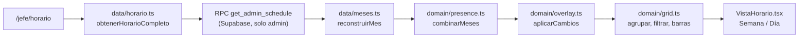

# Horario completo

**Qué hace (para el usuario):** jefatura ve el horario de toda la operación en una grilla semanal
(nombre fijo, un día por columna) o en una línea de tiempo por día, agrupado por departamento, con
filtros de nombre/sede/rol. Toca un nombre para ver la semana de esa persona en un panel lateral.
**Fase 4 del plan: solo lectura.** Cambiar un día, el registro de cambios y compartir alcances
distintos a «toda la operación» llegan en las Fases 5 y 7 (ADR-0016).

**Dónde:** `/jefe/horario` · capturas de referencia `10-jefe-horario-semana.png`,
`17-jefe-vista-rapida-persona.png` y `18-jefe-horario-dia.png`.

## Cómo funciona

`Horario.tsx` resuelve cargando/error antes de pintar `VistaHorario.tsx`, igual que `Empleado.tsx`
en la Fase 3.

## Archivos

| Archivo | Responsabilidad |
|---|---|
| `src/features/horario/Horario.tsx` | Punto de entrada: pide el horario, resuelve el estado |
| `src/features/horario/VistaHorario.tsx` | La pantalla: filtros, vista Semana, vista Día, vista rápida |
| `src/features/horario/horario.css` | Grid, columna de nombre fija y línea de tiempo 00–24 |
| `src/data/horario.ts` | Llama `get_admin_schedule` y reconstruye los tipos del dominio |
| `src/data/meses.ts` | Reconstrucción jsonb → dominio, compartida con `sharedView.ts` (Fase 3) |
| `src/domain/grid.ts` | Agrupar por departamento, filtrar, posición de las barras de la vista Día |
| `src/domain/presence.ts` | `combinarMeses` (compartido con la vista de empleado), índice, semana |
| `src/domain/overlay.ts` | El horario efectivo: hoja + cambios de jefatura (Fase 3) |
| `supabase/migrations/20261104190000_get_admin_schedule.sql` | RPC interna, solo `is_admin()` |

## Datos

`get_admin_schedule()` no recibe parámetros ni pasa por `share_links`: solo comprueba `is_admin()` y
devuelve `months`/`overrides` con la misma forma que `get_shared_view` (Fase 3), reutilizando el
mismo patrón de filtrar cada mes también por fecha dentro de `month_versions.month`, no solo por
`import_id` — ver «Bug real» en `docs/features/empleado.md` para el porqué. `src/data/meses.ts` saca
esa reconstrucción de `sharedView.ts` a un módulo compartido para que `horario.ts` no la duplique.

## Reglas y parámetros

- **Meses combinados, no un selector de mes (ADR-0016):** igual que la vista de empleado,
  `combinarMeses` junta todos los meses activos para que una semana que cruza de un mes a otro (p.
  ej. 30 nov – 6 dic) no se corte. Verificado a mano: el 30 de noviembre muestra datos reales y el 1
  de diciembre «Sin datos» sin romper nada, cuando diciembre todavía no está publicado.
- **Agrupar por departamento, no por rol:** dos departamentos pueden compartir rol (`MEGA N1` y
  `CC N1` son ambos `N1`), así que el grupo es el departamento tal como viene en la hoja
  (`domain/grid.ts`, `agruparPorDepartamento`). Orden alfabético, todos los grupos abiertos por
  defecto (ADR-0016, punto 3).
- **Vista Semana:** celda coloreada por categoría del turno (mañana/tarde/noche), con el punto y el
  borde punteado naranja si ese día tiene un cambio de jefatura vigente (`tieneCambio`, reutilizado
  de `domain/overlay.ts`). Total de horas y turnos por persona con `resumirSemana` (Fase 1).
- **Vista Día:** línea de tiempo 00–24 por persona. Un turno que cruza medianoche se recorta a la
  medianoche (`barraDeHoy`); la parte que viene de un turno de **ayer** que cruzó aparece como barra
  punteada desde las 00:00 (`barraDeAyer`), con el texto «hasta HH:MM (de ayer)». Quien solo tiene
  esa barra punteada (su turno real de hoy es Libre) sigue apareciendo en la lista de «en turno», no
  en el texto de libres — igual que el mockup.
- **Tocar una celda, «Cambios», «Compartir» y «Editar» están deshabilitados** con un indicador
  «Próximamente»: esas acciones son de las Fases 5 y 7 (ADR-0016, punto 1).

## Pruebas

- `tests/domain/grid.test.ts` (14 casos): agrupar y ordenar por departamento, filtrar por
  nombre/sede/rol combinados, contar en turno, la posición de la barra de hoy (con y sin recorte a
  medianoche) y la de ayer (incluida la clave: usar el tono de **texto**, no el de **fondo**, para
  que el borde punteado con `currentColor` se vea — ver «Bug real» abajo).
- `tests/domain/presence.test.ts`: 3 casos nuevos para `combinarMeses` (junta fechas y entradas, no
  duplica una persona que aparece en dos meses, un solo mes se combina igual a sí mismo).
- `tests/db/get_admin_schedule.test.ts` (6 casos): `anon` no puede llamarla, un autenticado que no es
  admin recibe un error, un admin sí puede, los datos de un mes publicado, un cambio de jefatura sin
  exponer quién lo hizo, y la misma regresión de Fase 3 (un import que cubre dos meses no mezcla sus
  entradas).

### Bug real encontrado probando en el navegador

La barra punteada «de ayer» (turno que cruza medianoche) no se veía: el código le daba el tono de
**fondo** de la categoría (un pastel muy claro, pensado para colorear un bloque sólido) como `color`
CSS, y el borde punteado usa `border: 1px dashed currentColor` — con un pastel casi blanco de
`color`, el borde era invisible sobre el fondo de la línea de tiempo. Se vio recién al probar con un
turno real `20:00–06:00` (persona con clave `ABRIL NARVAEZ OYARZUN QUELA`, ya conocida de la Fase 3)
y mirar el día siguiente: el texto decía «hasta 06:00 (de ayer)» pero no había ningún trazo visible.
Corregido usando el tono de **texto** de la categoría (el más oscuro, pensado para contraste), que es
exactamente lo que el mockup hace (`color` es el tono de texto de su clase `k-n`, no el de fondo).

- **Probado a mano en el navegador** con el fixture anonimizado real (106 personas, 26 departamentos,
  octubre y noviembre en un solo import): vista Semana y Día con datos reales, plegar/desplegar un
  grupo, los tres filtros combinados, la vista rápida de una persona, navegar semanas incluido el
  límite de mes (30 nov – 6 dic), y confirmar que «Cambios», «Compartir» y «Editar» se ven pero no
  hacen nada. Sin errores ni warnings en consola.

## Decisiones

[ADR-0003](../adr/0003-cambios-como-capa.md) · [ADR-0009](../adr/0009-catalogo-en-codigo.md) ·
[ADR-0016](../adr/0016-horario-completo-fase-4.md)

## Origen

Reescrito desde cero sobre la estructura de `GridOps.dc.html` (plan §7.4), que en realidad cubre tres
fases (4, 5 y 7) en un solo prototipo — ver ADR-0016 para qué se tomó de ahí y qué se dejó para
después. Los textos «Horario completo», «Buscar persona», «Sede», «Rol», «Semana», «Día», «Hoy»,
«Mañana / día», «Tarde», «Noche (+1)», «Vacaciones», «Cambiado por jefatura», «Nadie coincide con
estos filtros.» son literales del mockup. El texto de ayuda de la cabecera y los botones
deshabilitados son la diferencia documentada en ADR-0016.

## Pendiente / Próximamente

- Tocar una celda para cambiar un día, «Cambios · n» con su registro, «Editar» y «Compartir su
  horario» desde la vista rápida: Fase 5.
- El diálogo completo de «Compartir» con los cinco alcances: Fase 7.
- Comparación pixel a pixel contra las capturas 10/17/18 (hoy la pantalla es funcional, probada con
  datos reales, pero no se revisó contra la captura real — igual que Fuente y Empleado en fases
  anteriores).
