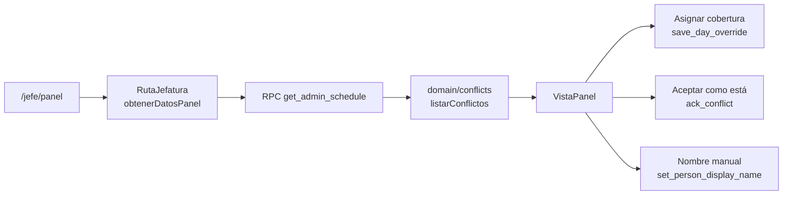

# Panel y conflictos

**Qué hace (para el usuario):** jefatura abre `/jefe/panel` y ve el día elegido (métricas, franjas,
cobertura por sede y departamentos) y, debajo, los conflictos de todo el horario publicado. Puede
filtrar pendientes, resueltos o todos. Resolver una cobertura asigna a alguien con un cambio de un
día; «Aceptar como está» deja la hoja como está y guarda una nota. El menú muestra cuántos quedan
pendientes.

**Dónde:** `/jefe/panel` · capturas `08` y `09` · mockup `DashOps.dc.html`.

## Cómo funciona

Los conflictos no se guardan. Son funciones puras sobre el horario efectivo (hoja + cambios de
jefatura), como dice [ADR-0007](../adr/0007-conflictos-como-funciones-puras.md). Lo único que se
persiste es «aceptar como está» (`conflict_acks`) y, cuando la acción es un cambio de un día, el
`day_override` con `conflict_key`.

El día que se elige arriba cambia las métricas y las barras. La lista de conflictos es de todo el
horario cargado, no solo de ese día. Si hoy está entre las fechas publicadas, el panel abre en hoy;
si no, en la fecha más reciente que no pasa de hoy.

## Archivos

| Archivo | Responsabilidad |
|---|---|
| `src/domain/conflicts/` | Una regla por archivo, más el evaluador que agrupa y marca resueltos |
| `src/domain/panel.ts` | Franjas, sedes y departamentos de un día |
| `src/domain/config.ts` | Umbrales propuestos (bloqueo §2): descanso, racha, hueco, sedes con supervisión |
| `src/data/panel.ts` | Lee el horario y los acks; acepta, deshace y fija el nombre |
| `src/features/panel/Panel.tsx` | Estado de carga del layout |
| `src/features/panel/VistaPanel.tsx` | La pantalla: métricas, filtros, tarjetas y barras |
| `src/features/panel/panel.css` | Métricas, tarjetas, barras y botones del panel |
| `src/app/RutaJefatura.tsx` | Pide los datos una vez y pone el número de pendientes en el menú |
| `supabase/migrations/20261104210000_panel_conflictos.sql` | `conflict_key` en el cambio, acks en la lectura, y las tres RPC nuevas |

## Reglas

Las 16 del plan §7.3, en `docs/datos/reglas-conflictos.md`. Resumen de cómo se calculan:

- **Cobertura de supervisión.** En Megacentro y Tuscania, huecos de 60 minutos o más sin alguien
  que cubra la sede. Cuenta un supervisor (salvo «Supervisor Tercerias») o Coordinador Operaciones
  cuya sede efectiva ese día sea esa. El turno de ayer que cruza medianoche cubre el tramo de hoy
  hasta donde termina. Las opciones son quienes están libres ese día, de esos mismos roles.
  Asignar escribe un turno `work` en el hueco, con motivo «Apoyo a otra sede» y la clave del
  conflicto representativo. Si no hay nadie disponible, la acción queda deshabilitada. Al recargar,
  esa clave ya no se detecta y la tarjeta pasa a resueltos por «cambio».
- **Descanso corto** (menos de 8 h entre dos días seguidos trabajados, del mismo mes) y
  **descanso justo** (8 h o más y menos de 9 h). Exactamente 9 h no es ninguno de los dos.
- **Racha larga:** 7 días seguidos o más.
- **Sede sin supervisión:** la sede tiene N1 o N2 y nadie con rol Supervisor. También marca Santa
  Ana, San Miguel y Atento cuando cumplen eso; el caso de control del plan pide al menos Phoenix
  Tower.
- **Hueco de equipo:** ventana habitual del mes (unión de los turnos efectivos de ese departamento)
  menos quien está ese día, si el hueco llega a 60 minutos.
- **Formato:** valor no reconocido, persona duplicada en la hoja leída, departamento desconocido o
  mal escrito, fecha en el nombre, vacaciones en mayúsculas, nombre con coma, orden de nombre
  dudoso y cambios contra el mes anterior.
- **Cambio huérfano** y **cambio ya en la hoja:** un override sin entrada ese día, o uno que ya
  coincide con la celda.

Las de formato y las informativas solo ofrecen «Aceptar como está» (o «Guardar nombre» en el orden
dudoso, que llama `set_person_display_name` y deja `display_name_source = manual`). No se edita la
hoja. Los botones del mockup que inventan una acción (día libre, responsable fijo de sede,
normalizar la celda) no están: el plan §7.3 manda.

Varios casos de la misma regla y el mismo grupo salen en una tarjeta. El representante es el de
fecha más temprana. Aceptar marca todas las claves del grupo. Asignar cobertura usa solo la clave
del representante, así el siguiente día sigue pendiente.

## Datos

| Dato | Dónde vive | Notas |
|---|---|---|
| Horario publicado | `get_admin_schedule` | Ahora incluye `displayNameSource`, `conflictKey` y `acks` |
| Cambio que resuelve | `day_overrides.conflict_key` | Lo escribe `save_day_override` |
| Aceptado como está | `conflict_acks` | `ack_conflict` revoca el vigente de esa clave e inserta otro. `revoke_conflict_ack` lo deshace |
| Nombre elegido | `people.display_name` + `display_name_source` | `set_person_display_name`. Un nombre vacío responde `NOMBRE_VACIO`; una persona que no existe, `PERSONA_DESCONOCIDA` |

Las tres funciones nuevas son `security definer`, con `search_path` fijo, sin acceso para `anon` y
solo ejecutables por `authenticated` que pase `is_admin()`.

## Errores

| Qué pasa | Qué ve la persona |
|---|---|
| No se pudo leer el horario | «No se pudo cargar el panel. Vuelve a intentarlo.» |
| Falló guardar, aceptar o deshacer | «No se pudo guardar. Vuelve a intentarlo.» en la tarjeta. El resto del panel sigue |
| Nombre vacío o persona desconocida | El mismo aviso de la tarjeta; la base rechaza con `NOMBRE_VACIO` o `PERSONA_DESCONOCIDA` |

## Diferencias con el mockup

- Los textos de las franjas dicen la regla real (antes de las 08:00, 08:00–12:00, 12:00–17:00,
  desde las 17:00). Los rangos de ejemplo del mockup no coinciden con su propio conteo ni con el
  plan §5.3.
- El renglón de arriba es «Hoja {mes}». No se inventa «revisada hace 5 min».
- «Ver los N →» abre `/jefe/horario`. El número es el de departamentos de ese día, no un 26 fijo.
- El descanso justo de noviembre da **12** con la fórmula escrita (8 h o más y menos de 9 h, entre
  días seguidos trabajados). El «17» del plan no aparece en esta hoja: hay 12 descansos de 8 h
  exactas y 1 de 9 h, que no entra. Octubre tiene 21 de 8 h. El resto de cifras de control del 2 de
  noviembre sí cuadra.

## Pruebas

- `tests/domain/conflicts.test.ts`: cada regla con un caso que dispara y otro que no, más asignar
  cobertura (el hueco se cierra y pasa a resueltos) y aceptar un conflicto de formato.
- `tests/domain/conflicts-control.test.ts`: el fixture anonimizado, con las cifras de arriba.
- `tests/local/conflictos.test.ts`: las mismas cifras sobre el Excel real, si está en la máquina
  (`npm run test:local`; se omite si no hay archivo).
- `tests/db/conflictos.test.ts`: anon y no-admin no aceptan; el admin acepta y deshace; el cambio
  guarda `conflict_key`; el nombre manual queda en la lectura.

## Pendiente

Los umbrales siguen **Propuestos** (bloqueo §2 de `docs/progreso.md`). No hay ADR nuevo: se usaron
los valores ya escritos en `config.ts`.
