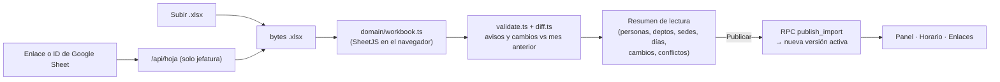

# ShiftSync v2 — Plan de implementación del MVP

**Para:** Claude Code (ejecuta) y Ado (decide y revisa)
**Fecha:** 2 nov 2026 · **Meta:** MVP en producción a finales de noviembre 2026 · **Presupuesto:** $0 (solo capas gratuitas)
**Diseño aprobado:** `referencias/diseno/` (capturas + fuentes de los mockups) · **Repo anterior:** https://github.com/JAPEREZ-L001/ShiftSync (solo lectura)

---

## 0. Cómo usar este plan

1. Crea el repo nuevo (ver §13, pregunta 3) y copia este archivo a `docs/plan-implementacion.md`.
2. Copia la carpeta `referencias/` del paquete a la raíz del repo. **Está en `.gitignore`**: contiene nombres reales. Pon el Excel real en `referencias/privado/`; solo se usa para pruebas locales y para generar el fixture anonimizado.
3. Clona el repo anterior dentro de ella, solo para leer:
   `git clone --depth 1 https://github.com/JAPEREZ-L001/ShiftSync referencias/legado`
4. Trabaja **una fase por sesión** de Claude Code (§10), en orden. Cada sesión empieza en modo plan con el prompt del Anexo B y termina cumpliendo la *Definición de terminado* (§9.3).
5. Modelo sugerido:
   - **Opus** (`/model opus`): fases 0, 1, 2, 6 y la revisión de la 8. Son decisiones, el parser, las reglas y la seguridad.
   - **Sonnet** (`/model sonnet`): fases 3, 4, 5 y 7. Son pantallas que siguen las capturas.

> Este plan es un documento vivo. Si algo se decide distinto durante la implementación, se escribe un ADR y se actualiza este archivo en el mismo cambio.

---

## 1. Qué construimos

ShiftSync lee el horario mensual de la operación (Excel o Google Sheet, ~100 personas, 26 departamentos, 7 sedes) y lo muestra a dos públicos.

| Público | Qué puede hacer en el MVP | Cómo entra |
|---|---|---|
| **Empleado** | Buscar su nombre, ver su semana y su día, ver **quién está ese día** (mismo horario / su equipo / toda la operación), ver si jefatura le cambió un día | Enlace de solo lectura que comparte jefatura. Sin cuenta |
| **Jefatura** | Cargar el horario (Excel o enlace/ID de Google Sheet), ver el panel con **conflictos** y resolverlos, ver el horario completo, **cambiar un día** (turno, sede, compañero de apoyo, motivo y nota), deshacer cambios y **generar enlaces** para compartir | Google (Supabase Auth) + lista de correos permitidos |

Todo lo demás aparece en la interfaz como **Próximamente**: visible, deshabilitado, sin comportamiento falso (§7.7).

---

## 2. Principios no negociables

1. **La hoja es la fuente de verdad y nunca se escribe en ella.** Los cambios de jefatura son una capa guardada en la base que se aplica encima del horario leído.
2. **Nada está terminado sin documentación.** Cada decisión lleva un ADR y cada funcionalidad su ficha. Cada cambio entra en el CHANGELOG (§9).
3. **Reinicio limpio.** El repo anterior se lee para entender cómo funcionaba. No se copian archivos: se reescribe tomando la idea y se cita el origen en la ficha.
4. **La lógica de negocio es pura y probada.** Vive en `src/domain/`, sin React ni Supabase, y tiene pruebas unitarias.
5. **Ningún dato personal real en el repo.** Ni en código, ni en pruebas, ni en docs. Se usan fixtures sintéticos o anonimizados.
6. **$0.** Si una pieza no cabe en una capa gratuita, se discute en un ADR antes de usarla.
7. **Fidelidad al diseño.** Estructura, textos, colores y comportamiento como en las capturas. Las diferencias permitidas están en §7.8. Cualquier otra lleva ADR.

---

## 3. Decisiones de arquitectura iniciales (ADRs)

En la Fase 0, Claude Code escribe cada una como `docs/adr/NNNN-titulo.md` con la plantilla del §9.4. Quedan en estado **Aceptado**, salvo que se indique otra cosa.

| ADR | Decisión | Por qué | Descartado |
|---|---|---|---|
| 0001 | Repo nuevo. El anterior queda como referencia de solo lectura | El alcance cambió: de un usuario y Google Calendar a una operación con dos roles. Arrastrar el código anterior mezcla dos modelos | Reiniciar el repo actual en una rama: posible si Ado lo prefiere (§13) |
| 0002 | Stack: **React 19 + TypeScript + Vite + Tailwind v4**, **Supabase** (Postgres, Auth, RPC), **Vercel** (sitio estático + funciones `/api`) | Es el stack que ya funcionó en v1. Cabe en capas gratuitas y lo mantiene una sola persona | Next.js + Prisma (ADR-001/002 del PRD anterior): más piezas de las que el MVP necesita. RLS y RPC de Supabase cubren el acceso a datos |
| 0003 | Los cambios de jefatura son una **capa** (`day_overrides`) sobre el horario importado. Nunca se escribe la hoja | La hoja la arma coordinación y no se puede tocar (sin Apps Script ni extensiones). Es la idea del Sprint 2 de v1, pasada de `localStorage` a Postgres para que la vean todos | Escribir en la hoja |
| 0004 | **Un solo camino de lectura**: todo entra como `.xlsx`, subido o exportado desde Google Sheets, y pasa por el mismo parser en el navegador | Un solo parser que probar y mantener | Leer la Sheet por API celda a celda: segundo formato y segundo parser |
| 0005 | Google Sheet en el MVP: **exportar `.xlsx` de una hoja compartida como «Cualquier persona con el enlace · Lector»** mediante la función `/api/hoja` (solo jefatura). **Estado: Propuesto** hasta cerrar §13-1 | Hoy la hoja pide iniciar sesión. La exportación pública no requiere credenciales ni modificar la hoja | Cuenta de servicio como lectora (si coordinación puede agregar un correo). OAuth de la jefatura: queda como «Próximamente» |
| 0006 | Acceso: jefatura con **Google + lista permitida** (`admins`). Empleados **sin cuenta**, con enlaces de solo lectura que vencen y se pueden revocar | El horario se usa para apoyarse entre áreas y no hay restricción de visibilidad. Pedir cuenta a 100 personas frena la adopción | Cuentas para todos. Riesgo aceptado: quien tenga el enlace ve la operación mientras no venza |
| 0007 | Los **conflictos son funciones puras** sobre el horario efectivo (hoja + cambios). Solo se guarda «aceptado como está». «Resolver» = crear un cambio de jefatura | Un conflicto resuelto desaparece solo porque los datos cambiaron. Nada se desincroniza | Guardar conflictos como filas con estado |
| 0008 | Tiempo: fechas `YYYY-MM-DD` locales + minutos desde medianoche, zona `America/El_Salvador`. Un turno que termina **00:00** termina ese mismo día y no lleva «+1» | Evita errores de zona horaria con `Date`. Coincide con el mockup (`15:00–00:00` no cuenta como «cruza medianoche») | Guardar `timestamptz` por turno |
| 0009 | El **catálogo de departamentos** (departamento → rol, sede, área) vive en código y en git | Cambia poco, se revisa en el PR y se prueba | Tabla editable en la base: queda para después |
| 0010 | **Versiones de importación**: publicar crea una versión. Cada mes apunta a su versión activa y se puede volver a una anterior | Recargar la hoja es lo más frecuente. Se necesita poder volver atrás en producción | Sobrescribir los datos |
| 0011 | **Datos personales fuera del repo**: `referencias/` ignorada; fixtures sintéticos o anonimizados por script | El repo anterior es público y la hoja tiene datos de ~100 compañeros | — |

---

## 4. Estructura del repositorio

```
shiftsync/
├─ CLAUDE.md                    # reglas para Claude Code (Anexo A)
├─ README.md                    # qué es, cómo correrlo, enlaces a docs
├─ CHANGELOG.md                 # Keep a Changelog
├─ .env.example                 # todas las variables, comentadas
├─ vercel.json                  # rewrites del SPA + headers
├─ .github/
│  ├─ workflows/ci.yml          # check + docs:check en cada PR
│  └─ pull_request_template.md  # checklist de la Definición de terminado
├─ api/
│  └─ hoja.ts                   # descarga el .xlsx exportado de una Google Sheet (solo jefatura)
├─ supabase/
│  └─ migrations/               # esquema, RLS y RPC; una migración por cambio
├─ src/
│  ├─ domain/                   # TypeScript puro: sin React, sin Supabase, 100% con pruebas
│  │  ├─ types.ts
│  │  ├─ config.ts              # umbrales, catálogos y franjas, todos documentados
│  │  ├─ time.ts                # DateKey, minutos, semana que empieza en lunes
│  │  ├─ shift.ts               # interpretar una celda + categoría de color
│  │  ├─ names.ts               # clave estable de persona + nombre a mostrar
│  │  ├─ catalog.ts             # departamento → rol, sede, área
│  │  ├─ workbook.ts            # libro SheetJS → meses → personas → días
│  │  ├─ validate.ts            # avisos de importación
│  │  ├─ diff.ts                # cambios contra el mes anterior
│  │  ├─ overlay.ts             # horario efectivo = hoja + cambios de jefatura
│  │  ├─ presence.ts            # quién está un día, franjas, por sede, por departamento
│  │  ├─ conflicts/             # una regla por archivo + index.ts
│  │  └─ share.ts               # alcance de un enlace → qué datos se muestran
│  ├─ data/                     # acceso a Supabase (consultas y RPC), sin lógica de negocio
│  ├─ features/
│  │  ├─ empleado/
│  │  ├─ fuente/
│  │  ├─ panel/
│  │  ├─ horario/               # incluye cambiar un día y registro de cambios
│  │  └─ compartir/
│  ├─ ui/                       # componentes base + tokens.css
│  └─ app/                      # rutas, sesión, layouts
├─ tests/
│  ├─ domain/                   # unitarias
│  ├─ fixtures/                 # libros sintéticos y anonimizados (sin nombres reales)
│  └─ e2e/                      # Playwright
├─ scripts/
│  ├─ anonimizar-excel.ts       # real → anonimizado (el real nunca se commitea)
│  └─ check-docs.ts             # valida índice y fichas (§9)
├─ docs/                        # ver §9.1
└─ referencias/                 # .gitignore: diseno/, legado/, privado/ (Excel real)
```

Convenciones:
- Identificadores de código en inglés. Textos de UI y documentación en español.
- Cada archivo de `src/domain` y `src/features` empieza con un comentario de 2–3 líneas: qué hace y qué ficha de `docs/` lo describe.

---

## 5. Modelo de dominio y datos

### 5.1 Glosario

Va a `docs/producto/prd.md`, con su equivalente en código.

| Término | En código | Significado |
|---|---|---|
| Hoja / libro | `Workbook` | El Excel o la Google Sheet completos. Trae una pestaña por mes |
| Turno | `ShiftValue{kind:'work'}` | Celda `HH:MM-HH:MM`. Puede terminar al día siguiente |
| Libre | `kind:'off'` | Día de descanso |
| Vacaciones | `kind:'vacation'` | Cualquier variante de «vacaciones» |
| Sin dato | `kind:'unknown'` | Vacío o valor no reconocido. Siempre genera aviso |
| Departamento | `Department` | Columna A tal como viene (ej. `MEGA N1`) |
| Rol | `Role` | N1, N2, Supervisor, Coordinador, Producto, Tercería, Redes, Soporte de Salas, QA, Activo Fijo |
| Sede | `Site` | Megacentro, Tuscania, Phoenix Tower, Atento, Santa Ana, San Miguel, Activo Fijo, o *Sin sede* |
| Cambio de jefatura | `DayOverride` | Reemplazo de un día de una persona, con motivo y nota |
| Horario efectivo | `EffectiveDay` | Hoja + cambios de jefatura. Es lo que se muestra y lo que revisan las reglas |
| Conflicto | `Conflict` | Incoherencia que detecta una regla, con severidad alta, media o baja |
| Enlace | `ShareLink` | URL de solo lectura con alcance, vencimiento y revocación |

### 5.2 Contrato de la hoja

Analizado sobre `Horarios_Octubre-Diciembre_3.xlsx`. Va a `docs/datos/formato-hoja.md`.

- **Una pestaña por mes.** Se ignoran `CONTACTOS` y las que empiezan con `_` (como en v1).
- **Pestañas ocultas:** `Septiembre` viene **oculta**. Se listan, pero no se seleccionan por defecto.
- **Fila 1:** nombre del día, con fórmulas `=TEXT(C2,"dddd")`. Se ignora.
- **Fila 2:** fechas reales (`Date`). Cada columna se empareja con **su** fecha de la fila 2. Una columna cuya fila 2 no es fecha **no es un día**. Esto ya lo hacía v1 y cubre dos casos:
  - `Septiembre` empieza las fechas en la **columna D**. La C trae una fórmula de horas con encabezado `184/163`.
  - `Septiembre` termina con una columna `Libres por` con `=COUNTIF(...)`.
- **Columna A:** departamento. **Columna B:** nombre. **Filas 3+:** una persona por fila. Filas sin nombre se ignoran.
- **Celdas de día** (noviembre): turnos `HH:MM-HH:MM`, `Libre` (972), `Vacaciones` (73) y `VACACIONES` (15).
- El color de celda es decorativo y no se usa.
- Tamaños reales: Octubre tiene 98 personas y 31 días. Noviembre tiene 103 personas y 30 días.

### 5.3 Interpretación de una celda (`shift.ts`)

| Entrada (normalizada: sin tildes, mayúsculas, espacios simples) | Resultado |
|---|---|
| `^(\d{1,2}):(\d{2})\s*-\s*(\d{1,2}):(\d{2})$` | `work`: `startMin`, `endMin`. Si `end <= start` se suma 1440 |
| `LIBRE` | `off` |
| contiene `VACAC` | `vacation` |
| vacío u otro | `unknown`: se guarda `raw` y genera aviso |

- `endsNextDay = endMin > 1440`. Por eso `15:00-00:00` termina a las 24:00 del mismo día (ADR-0008).
- La duración es `endMin - startMin`.
- **Categoría de color** según la hora de entrada: `< 12:00` mañana/día, `< 17:00` tarde, el resto noche.
- **Franjas del panel** (otra cosa, solo para conteo): entrada `< 08:00` Mañana, `< 12:00` Día, `< 17:00` Tarde, resto Noche.

### 5.4 Catálogo de departamentos (`catalog.ts`)

Va a `docs/datos/catalogo-departamentos.md`. Primero se busca la coincidencia exacta normalizada en esta tabla. Si no hay, se aplican reglas por prefijo y sufijo. Si tampoco, el departamento queda **desconocido**: `Sin sede`, rol `Otro`, y genera un conflicto.

| Departamento (hoja nov.) | Rol | Sede | Área |
|---|---|---|---|
| Coordinador Operaciones | Coordinador | — | Operación |
| Adminsitrador de Redes *(sic; alias «Administrador de Redes»)* | Redes | — | |
| Activo Fijo | Activo Fijo | Activo Fijo | |
| SUP MEGA | Supervisor | Megacentro | |
| SUP CC | Supervisor | Tuscania | |
| Atencion Gestion Salas | Soporte de Salas | — | |
| MEGA N1 / MEGA N2 | N1 / N2 | Megacentro | |
| CC N1 / CC N2 | N1 / N2 | Tuscania | |
| Phoenix N1 / Phoenix N2 | N1 / N2 | Phoenix Tower | |
| AT N1 | N1 | Atento | |
| Coordinador de Producto | Coordinador | — | Producto |
| Supervisor Tercerias | Supervisor | — | Tercería |
| Especialistas de Producto | Producto | — | |
| Tercerias | Tercería | — | |
| Especialistas de Redes | Redes | — | |
| Auxiliares de Red y Soporte | Redes | — | |
| Coordinador Santa Ana | Coordinador | Santa Ana | |
| N1 ST ANA | N1 | Santa Ana | |
| Coordinadora San Miguel | Coordinador | San Miguel | |
| N1 SAN MIGUEL | N1 | San Miguel | |
| Auxiliares de Red y Soporte-SM | Redes | San Miguel | |
| Soporte Tecnologico y Salas | Soporte de Salas | — | |
| QA | QA | — | |

Reglas de respaldo (vienen de `location.ts` de v1, ampliadas):
- Sede: `MEGA`→Megacentro, `CC`→Tuscania, `PHOENIX`→Phoenix Tower, `AT`→Atento, `ST ANA`/`SANTA ANA`→Santa Ana, `SAN MIGUEL`/`SM`/`-SM`→San Miguel.
- Rol: `SUP`→Supervisor, `N1`, `N2`, `COORDINADOR(A)`→Coordinador.

### 5.5 Personas y nombres (`names.ts`)

**Clave estable** de persona (para unir meses y cambios de jefatura):
1. Quitar el sufijo `(d/m)`. Se interpreta como **fecha de ingreso**, con el año de la pestaña.
2. Quitar comas y normalizar.
3. **Ordenar los tokens alfabéticamente.**

Así `MARTINEZ ROSALES ANA LUCIA` y `Ana Lucía Martínez Rosales (3/11)` son la misma persona (ejemplos ficticios en todo este plan).

**Nombre a mostrar**, siempre «nombres + apellidos»:
1. Si trae `APELLIDOS, NOMBRES`, se invierte.
2. Si viene en mayúsculas y minúsculas mezcladas, se asume que ya está en orden nombre-apellido (pasa con los ingresos del 3 nov).
3. Si viene todo en mayúsculas:
   - Se agrupan las partículas con la palabra siguiente: `DE`, `DEL`, `DE LA`, `DE LOS`, `LA`, `LAS`, `Y`.
   - Se reparten los grupos así: 2 grupos → 1 apellido + 1 nombre; 3 → 1 + 2; 4 → 2 + 2; 5 o más → 2 apellidos + el resto nombres.
   - Ejemplo: `CRUZ DE MOLINA SOFIA ELENA` → «Sofia Elena Cruz de Molina».
4. Si el primer grupo está en la lista de nombres comunes de `config.ts` y el último no, el nombre **probablemente ya viene en orden nombre-apellido**. Se deja como está y se marca `needsReview` (ej. `JUAN PABLO RAMOS RAMOS`). Genera el conflicto «Revisa el orden de N nombres».
5. Capitalización tipo título, con partículas en minúscula salvo al inicio. Se conservan las tildes del original.
6. Jefatura puede corregir el nombre a mostrar. La corrección se guarda como `display_name_source = 'manual'` y se respeta en las importaciones siguientes.

Orden de listas: por nombre a mostrar, con `localeCompare('es')`.

### 5.6 Base de datos (Supabase Postgres)

Va a `docs/arquitectura/modelo-de-datos.md`, con diagrama ER en Mermaid. Todas las tablas tienen **RLS activado**. `anon` no lee ninguna tabla directamente.

```sql
admins            (email text pk, name text, created_at)
imports           (id uuid pk, source text check (source in ('excel','sheet')), source_label text,  -- nombre de archivo o ID de la hoja
                   sheet_gid text, months date[], content_hash text, summary jsonb, warnings jsonb,
                   imported_by uuid, imported_at timestamptz)
month_versions    (month date pk,                       -- primer día del mes
                   import_id uuid fk, activated_by uuid, activated_at timestamptz)  -- versión activa de cada mes
people            (id uuid pk, key text unique, last_raw_name text, display_name text,
                   display_name_source text check (display_name_source in ('auto','manual')),
                   joined_on date null, first_seen_import uuid, last_seen_import uuid)
schedule_entries  (import_id uuid fk, person_id uuid fk, date date, department text, raw text,
                   kind text, start_min int null, end_min int null,
                   primary key (import_id, person_id, date))
day_overrides     (id uuid pk, person_id uuid fk, date date, kind text, start_min int null, end_min int null,
                   site text null, reason text, note text, support_person_id uuid null,
                   conflict_key text null,              -- si nació al resolver un conflicto
                   created_by uuid, created_at timestamptz, revoked_at timestamptz null, revoked_by uuid null)
                   -- índice único parcial: (person_id, date) where revoked_at is null
conflict_acks     (id uuid pk, conflict_key text, note text, created_by uuid, created_at timestamptz,
                   revoked_at timestamptz null)         -- «Aceptar como está»
share_links       (id uuid pk, slug text unique, scope text, params jsonb, title text,
                   expires_at timestamptz, created_by uuid, created_at timestamptz,
                   revoked_at timestamptz null, last_opened_at timestamptz null)
```

Funciones (RPC, `security definer`, con `search_path` fijo):
- `is_admin()` → `bool`. Revisa `auth.jwt()->>'email'` contra `admins`.
- `publish_import(payload jsonb)` → `uuid`. Solo admin. En una transacción:
  - inserta `imports`, hace upsert de `people` por `key` y escribe `schedule_entries`;
  - apunta `month_versions` a la nueva versión para los meses elegidos.
- `activate_import(import_id, month)`. Solo admin. Es para volver a una versión anterior.
- `get_shared_view(slug)` → `jsonb`. Es la única vía de `anon`:
  - valida que el enlace no esté vencido ni revocado y actualiza `last_opened_at`;
  - devuelve personas, entradas de los meses activos dentro del alcance y cambios vigentes (motivo, nota y fecha; **nunca** quién lo hizo).

Deshacer un cambio = `revoked_at`. Editarlo = revocar el vigente e insertar uno nuevo. Así queda el historial completo.

---

## 6. Carga del horario (Excel y Google Sheet)

Es la parte más importante. Se apoya en v1 pero se reescribe limpia.

### 6.1 Qué tomar del repo anterior (`referencias/legado/`)

| Archivo v1 | Qué se reutiliza (como idea, reescrito) | Qué cambia en v2 |
|---|---|---|
| `src/lib/parser.ts` · `coerceSheetDate` | Acepta `Date`, serial de Excel, `YYYY-MM-DD` y `dd/mm/yyyy`, y devuelve fecha local. Necesario porque un `.xlsx` exportado de Google Sheets no siempre trae fechas tipadas | Devuelve `DateKey` (texto), no `Date` |
| `parser.ts` · `parseWorkbookAll` | `sheet_to_json(header:1, raw:true)`, emparejar columna con su fecha de la fila 2, hojas que no encajan van a `skipped` como aviso y no rompen la carga | Detecta pestañas ocultas. Devuelve **todas las personas** con departamento, rol y sede (v1 armaba el horario de una persona) |
| `parser.ts` · `parseShiftValue` | Regex de turno con espacios opcionales, `Libre`, `VACAC` | El turno que termina 00:00 no cruza (ADR-0008). `unknown` siempre genera aviso |
| `parser.ts` · `isIgnoredSheetName` | `CONTACTOS` y prefijo `_` | Igual |
| `src/lib/utils.ts` · `normalize`, `toKey` | Quitar tildes, mayúsculas, espacios simples; claves `YYYY-MM-DD` | La clave de persona usa tokens ordenados (§5.5) |
| `src/lib/location.ts` | Expresiones de sede y rol | Agrega Phoenix Tower, Activo Fijo, los 10 roles, área y *Sin sede*. Tabla explícita primero (§5.4) |
| `src/lib/overrides.ts` + `docs/sprints/Sprint-2.md` | Concepto de capa de excepciones que no reescribe el Excel | Pasa de `localStorage` a Postgres. Clave `person_id + date` (no el nombre). Suma sede, motivo, nota, apoyo, autor y deshacer con historial |
| `src/lib/share.ts` + `supabase/migrations/…links_estables.sql` | Patrón RLS sin lectura directa + RPC `security definer`. Re-parsear `raw` al leer para que el parser sea la única fuente de verdad | Enlaces con alcance, vencimiento y revocación. Los datos se calculan al abrir (incluyen cambios de jefatura), no se congela un JSON |
| `src/lib/stats.ts` | Idea de «relevo» (entran/salen ±90 min) | No entra al MVP. El empleado agrupa por hora de entrada (§7.1) |
| `package.json` | SheetJS desde `https://cdn.sheetjs.com/xlsx-0.20.3/xlsx-0.20.3.tgz` (la versión de npm está desactualizada) | Igual |
| `src/hooks/useSchedule.ts`, login simulado con PIN, componentes | — | **No se reutiliza.** Era un hook de 435 líneas con todo el estado. v2 separa dominio, datos y UI |
| `docs/init/*` (PRD de un usuario, ADR/TDD de Next.js) | Contexto histórico | Quedan como historia. No aplican |

Deuda conocida de v1 que v2 debe resolver: no lee Google Sheets, los cambios viven en un solo navegador, el login es simulado y no hay pruebas.

### 6.2 Flujo



### 6.3 Google Sheet

- **Interpretar la entrada** (lógica del mockup `Fuente.dc.html`, pasada a `domain`):
  - ID: `/spreadsheets/d/([a-zA-Z0-9_-]{20,})/` o el texto suelto si cumple `^[a-zA-Z0-9_-]{25,}$`;
  - `gid`: `[#&?]gid=(\d+)`.
  - Se muestran ID y gid en vivo.
- **`/api/hoja`** (función de Vercel):
  1. Recibe `{ id }` y el token de Supabase de la sesión.
  2. Valida token y `is_admin`.
  3. Arma **solo** `https://docs.google.com/spreadsheets/d/{id}/export?format=xlsx`. Nunca acepta una URL libre (evita SSRF).
  4. Descarga con un tope de 10 MB y un timeout.
  5. Si la respuesta no es un `.xlsx` (Google devuelve la página de inicio de sesión), responde `403` con el código `HOJA_PRIVADA`.
- **Mensaje en la UI para `HOJA_PRIVADA`:** «La hoja pide iniciar sesión. Pide a coordinación compartirla como "Cualquier persona con el enlace · Lector", o sube el Excel.»
- **Hoy la hoja de la operación está privada.** El MVP funciona igual con Excel. El acceso con Google o con cuenta de servicio depende de §13-1.
- **Pestaña:**
  - por defecto, la del `gid` del enlace si es un mes;
  - si no, el mes en curso;
  - con opción de elegir.
- **Frecuencia de revisión:** en el MVP solo «Revisar ahora». «Cada 15 minutos» y «Cada hora» se muestran como **Próximamente** (necesitan un cron, por ejemplo pg_cron de Supabase; se decide en ADR).

### 6.4 Recarga, versiones y cambios contra el mes anterior

- Publicar crea una versión. Los meses incluidos pasan a apuntar a ella y la anterior queda en el historial («Volver a esta versión»).
- `content_hash` del libro: si es idéntico al activo, se avisa «No hay cambios desde la última carga» y no se publica.
- **Diff contra el mes anterior** (`diff.ts`), comparando por clave de persona:
  - ingresos (incluye la fecha `(d/m)`);
  - salidas (personas que ya no aparecen);
  - cambios de departamento.
- **Los cambios de jefatura sobreviven a la recarga** porque se guardan por persona y fecha. Hay dos casos:
  - Si la hoja nueva ya trae el mismo valor que el cambio, el cambio se marca «ya está en la hoja» (conflicto baja, acción: archivar).
  - Si la persona ya no existe, conflicto media «Cambio sobre una persona que ya no está en la hoja».

### 6.5 Criterios de aceptación de la carga

- [ ] El Excel real carga sus tres pestañas. Septiembre aparece oculta y no seleccionada. Noviembre da **103 personas, 26 departamentos, 7 sedes (más «Sin sede») y días 1–30**.
- [ ] Septiembre se lee bien aunque sus fechas empiecen en la columna D y termine con la columna `Libres por`.
- [ ] `VACACIONES` y `Vacaciones` dan el mismo resultado. Una celda vacía o desconocida genera aviso y no rompe la carga.
- [ ] `21:00-06:00` dura 9 h y termina al día siguiente. `15:00-00:00` dura 9 h y **no** lleva «+1».
- [ ] Un enlace de Sheet privado da el mensaje `HOJA_PRIVADA`. Un ID inválido se rechaza antes de llamar a la función.
- [ ] Publicar dos veces el mismo archivo no crea otra versión.
- [ ] Volver a una versión anterior cambia lo que ven panel, horario y enlaces.
- [ ] Parsear el libro real tarda menos de 2 s en un portátil normal.

---

## 7. Funcionalidades por pantalla

Cada pantalla tiene su ficha en `docs/features/` (plantilla en §9.4). Textos: **literales de los mockups** (`referencias/diseno/mockups/*.dc.html`).

### 7.1 Empleado — `/s/:slug` · capturas 01–05 · `Empleado.dc.html`

- **Barra superior:** «ShiftSync · Horario de la operación · {Mes} {año}» y el estado de la fuente («Google Sheet · actualizado hace N min» o «Excel · cargado el …»).
- **¿Quién eres?:**
  - el buscador ignora tildes y mayúsculas y busca por cualquier parte del nombre;
  - muestra hasta 6 resultados con punto de color del rol, etiqueta de rol, «Ingresa d mmm» si es ingreso nuevo y departamento;
  - «Soy esta persona» guarda la elección en `localStorage` (try/catch). «Volver a mi horario» aparece cuando miras a otra persona.
- **Tu semana:**
  - 7 botones de lunes a domingo, cada uno con entrada/salida o «Libre»/«Vacaciones»;
  - punto naranja si jefatura cambió ese día;
  - navegación por semanas dentro de los meses activos (también cruza al mes anterior);
  - resumen «N turnos · H h en la semana».
- **Tarjeta del día:**
  - horario grande, duración, sede efectiva y «termina al día siguiente» si aplica;
  - etiqueta de categoría;
  - si hubo cambio, caja «Cambio hecho por jefatura · {fecha}» con antes tachado, motivo y nota.
- **Quién está ese día**, en tres segmentos con conteo:
  - *Mismo horario*: cualquier persona con exactamente el mismo valor de turno ese día. Se deshabilita si el día es libre.
  - *Mi equipo*: mismo departamento.
  - *Toda la operación*: todos los que trabajan ese día.

  La lista va agrupada por «Entran HH:MM · n» y ordenada por entrada y nombre. Cada fila lleva la franja de color del rol, rol, sede · departamento y horario. Tocar una fila muestra el horario de esa persona.
- **Próximamente:** Pasar a Google Calendar, Avisos para marcar, Cronómetro de horas, Vista de mes.
- **Estados:**
  - enlace vencido o revocado: «Este enlace ya no está activo. Pide uno nuevo a jefatura.»;
  - sin datos para la fecha: «Sin datos»;
  - cargando: esqueleto, sin parpadeos.
- **Móvil (390 px) es obligatorio** (§7.8).

### 7.2 Jefatura · Fuente de datos — `/jefe/fuente` · capturas 06–07 · `Fuente.dc.html`

- Tarjeta «Fuente actual»: tipo, nombre o ID, última lectura, versión activa por mes y botón «Revisar ahora».
- Pestañas deslizables «Enlace o ID de Google Sheets» / «Subir Excel (.xlsx)».
  - **Sheets:** campo con interpretación en vivo (ID y gid) y selector de pestaña. Acceso: «Enlace de solo lectura» (MVP) o «Con mi cuenta de Google — Próximamente». Frecuencia según §6.3.
  - **Excel:** zona para arrastrar o elegir archivo (solo `.xlsx`) y último archivo cargado.
- «Cómo debe venir la hoja»: resumen del §5.2.
- **Resumen de lectura:**
  - pestañas encontradas;
  - N personas, N departamentos, N sedes, días leídos;
  - cambios contra el mes anterior;
  - N conflictos y avisos de importación.

  Botones: **Publicar esta versión** (es la diferencia aceptada del §7.8) y, ya publicada, «Revisar conflictos», «Ver horario completo» y «Ver como empleado».
- Historial: versiones por mes con fecha, origen y «Volver a esta versión».

### 7.3 Jefatura · Panel y conflictos — `/jefe/panel` · capturas 08–09 · `DashOps.dc.html`

- **Navegación por día** (por defecto hoy).
- **4 métricas** del día. «En turno» cuenta los turnos que **empiezan** ese día:
  - En turno (de N);
  - Libres;
  - Vacaciones;
  - Cruzan medianoche.
- **Conflictos:**
  - filtros Pendientes / Resueltos / Todos con conteo, y conteo en el menú lateral;
  - cada conflicto es una fila plegable con severidad, tipo, título y línea resumen;
  - al abrirla: detalle, opciones (chips), nota opcional, botón de acción (deshabilitado hasta elegir opción si hay opciones), «Aceptar como está» y, si aplica, enlace al Horario completo;
  - resueltos con «Deshacer».
- **Resolver:**
  - Si la acción asigna a alguien, se crea un `day_override` con `conflict_key`. El conflicto desaparece solo porque la regla deja de cumplirse.
  - «Aceptar como está» crea un `conflict_ack` con nota. «Deshacer» revoca el cambio o el ack.
- **Cobertura del día:**
  - por franja (§5.3);
  - por sede (en turno / total, con *Sin sede*);
  - top 10 departamentos por tamaño (en turno, libres, vacaciones, total, barra) con enlace «Ver los 26».

**Reglas de conflicto** (`src/domain/conflicts/`, un archivo por regla, parámetros en `config.ts`). Va a `docs/datos/reglas-conflictos.md`. Una tarjeta por regla y por caso relevante; los casos repetidos se agrupan («se repite en 16 días más del mes»).

| id | Severidad | Tipo | Se dispara cuando… | Opciones / acción |
|---|---|---|---|---|
| `cobertura-supervision` | alta | Cobertura | En una sede de `SEDES_CON_SUPERVISION` (hoy Megacentro→`SUP MEGA`, Tuscania→`SUP CC`) hay ≥1 N1/N2 de esa sede en turno y 0 supervisores de esa sede, durante ≥ `HUECO_MIN` (60 min) | Supervisores libres ese día (todos menos `Supervisor Tercerias`) + `Coordinador Operaciones` → «Asignar cobertura» crea un cambio con ese horario y esa sede |
| `descanso-corto` | alta si < `DESCANSO_MIN_H` (8 h) | Descanso | Entre el fin de un turno y el inicio del siguiente de la misma persona | Ir al horario y editar · Aceptar |
| `descanso-justo` | baja si < `DESCANSO_AVISO_H` (9 h) | Descanso | Igual, entre 8 y 9 h | «Aceptar regla de 8 h mínimo» |
| `racha-larga` | media | Descanso | ≥ `RACHA_MAX` (7) días seguidos con turno | Editar · Aceptar |
| `sede-sin-supervision` | media | Estructura | Una sede tiene N1/N2 pero ningún departamento de supervisor (hoy Phoenix Tower) | Aceptar con nota |
| `hueco-equipo` | media | Cobertura | Un departamento N1/N2 queda con 0 personas ≥ 60 min dentro de su **ventana habitual** (unión de sus turnos del mes) | Ir al horario · Aceptar |
| `valor-no-reconocido` | media | Formato | Celda `unknown` | Editar el día · Aceptar |
| `persona-duplicada` | media | Estructura | Dos filas con la misma clave en un mes | Aceptar |
| `cambio-huerfano` | media | Cambios | Cambio vigente sobre una persona o fecha que ya no está en la hoja | Archivar cambio |
| `fecha-en-nombre` | baja | Formato | Nombre con `(d/m)` | Informativo (se interpreta como ingreso) |
| `vacaciones-mayusculas` | baja | Formato | Variantes de «Vacaciones» | Informativo |
| `nombre-con-coma` | baja | Formato | `APELLIDOS, NOMBRES` | Informativo |
| `departamento-desconocido` / `departamento-mal-escrito` | media / baja | Formato | Sin entrada en el catálogo / coincide con un alias (ej. «Adminsitrador») | Informativo, abre PR al catálogo |
| `orden-nombre-dudoso` | baja | Formato | `needsReview` (§5.5) | Chips «Nombre primero» / «Apellido primero» → guarda nombre manual |
| `cambios-vs-mes-anterior` | baja | Cambios | Ingresos, salidas y movimientos de departamento | Informativo |
| `cambio-ya-en-hoja` | baja | Cambios | La hoja nueva ya trae el valor del cambio | Archivar cambio |

La **clave estable** de un conflicto se forma como `regla:alcance`, por ejemplo `cobertura-supervision:tuscania:2026-11-02:14:00-18:00`. Con ella se asocian acks y cambios.

**Casos de control con la hoja real** (prueba local, §11). El panel debe encontrar al menos:
- Tuscania sin supervisor el lun 2 nov 14:00–18:00;
- Megacentro sin supervisor el mar 3 nov 06:00–15:00;
- 4 descansos de 6 h en Soporte de Salas (sale 00:00, entra 06:00);
- una racha de 9 días (5–13 nov) y otra de 7 (9–15 nov);
- Phoenix Tower sin supervisión;
- CC N1 sin N1 el jue 19 de 06:00 a 21:00, y CC N2 sin N2 el mié 18 de 14:00 a 21:00;
- 6 ingresos con `(3/11)`;
- 15 celdas `VACACIONES`;
- un nombre con coma;
- «Adminsitrador de Redes»;
- 12 cambios de departamento y 1 salida contra octubre;
- 12 descansos de 8–9 h (la cifra 17 del borrador no se reproduce: con la fórmula escrita hay 12
  descansos de 8 h y uno de 9 h exactas, que no entra por ser el límite superior).

Métricas del lun 2 nov:
- En turno 73 de 103, libres 29, vacaciones 1, cruzan medianoche 9.
- Franjas: Mañana 33, Día 8, Tarde 23, Noche 9.
- Por sede (en turno / total): Megacentro 15/22, Tuscania 12/18, Phoenix Tower 6/8, Santa Ana 5/5, San Miguel 4/5, Atento 1/2, Activo Fijo 3/3, Sin sede 27/40.

### 7.4 Jefatura · Horario completo — `/jefe/horario` · capturas 10, 17, 18 · `GridOps.dc.html`

- **Encabezado:** título, ayuda («Toca una celda para cambiar ese día · toca un nombre para ver su horario»), botón «Cambios · n» y botón «Compartir».
- **Segmentado Semana / Día** y navegación por semanas (lunes a domingo) con «Hoy».
- **Filtros:** buscar persona, Sede (incluye Phoenix Tower y Sin sede), Rol, y leyenda de colores.
- **Semana:**
  - grupos por departamento, plegables, con borde de color del rol, etiquetas de rol, sede y área, y «n personas · m en turno hoy»;
  - filas con nombre fijo a la izquierda (sticky) y columnas de día con la celda de color por categoría (entrada / → salida, «+1» si termina al día siguiente, sede si cambió);
  - total semanal (horas y turnos);
  - celda cambiada por jefatura con borde punteado naranja y punto;
  - columna de hoy resaltada.
- **Día:** chips de los 7 días y línea de tiempo 00–24 por persona con barra de color. El turno que viene de ayer va como barra punteada («hasta 06:00 (de ayer)»). Abajo de cada grupo: libres y vacaciones en texto. «Editar» por fila.
- **Vista rápida de persona** (panel lateral): su semana, resumen, «Editar {día}» y «Compartir su horario».

### 7.5 Jefatura · Cambiar un día — capturas 11–13b

Panel lateral sobre el horario, abierto desde una celda, desde «Editar» o desde la vista rápida.

- **Encabezado:** «Cambiar un día · {día}», nombre, departamento y el valor «en la hoja».
- **Turno:** Turno / Libre / Vacaciones. Con Turno:
  - horarios rápidos: los **6 turnos más frecuentes del departamento** ese mes;
  - campos de entrada y salida.
- **Alerta de descanso**, justo debajo del horario: si queda < 8 h con el día anterior o el siguiente, o si el turno dura > 12 h. **Avisa pero no bloquea.**
- **Sede ese día:** las 7 sedes, con la de la persona marcada «(su sede)».
- **Compañeros con el nuevo horario:**
  - quién tiene exactamente ese horario en esa sede;
  - «Asignar apoyo con (opcional)»: hasta 8 personas de esa sede cuyo turno se solapa.
- **Detalle del cambio:** motivo obligatorio (Cambio de turno, Apoyo a otra sede, Permiso, Incapacidad, Capacitación, Otro) y nota para la persona.
- **Vista previa:** antes tachado → después (+ sede). Avisar por notificación: **Próximamente**.
- **Botones:** «Guardar cambio» (deshabilitado sin motivo o sin horas), «Cancelar» y «Volver a lo de la hoja» si ya hay un cambio.
- Al guardar aparece un aviso verde («Cambio guardado: … La persona lo verá en su horario.») con «Compartir este cambio».
- **Registro de cambios** (captura 14):
  - lista por fecha con antes → ahora, motivo · apoyo · nota y «Jefatura · {cuándo}»;
  - «Compartir» y «Deshacer» (revoca; queda en el historial).

### 7.6 Jefatura · Compartir — capturas 15–16

- **Qué compartir.** Cada alcance abre la vista empleado con estas restricciones:

  | Alcance | Qué muestra el enlace |
  |---|---|
  | Toda la operación | Todo, con búsqueda |
  | Esta semana con los filtros | Fechas limitadas a esa semana; personas según sede y rol |
  | Un día | Solo ese día |
  | Una persona | Persona fija, sin buscador; «Quién está» sigue visible (sin restricción de visibilidad, ADR-0006) |
  | Un cambio | Persona y fecha fijas, con el cambio destacado |

- **Vence:** 24 horas, 7 días o fin de mes.
- **Enlace:**
  - campo de solo lectura y «Copiar» → «Copiado ✓» (`navigator.clipboard.writeText(...).catch(...)`; si falla, se selecciona el texto);
  - «Requerir correo de la empresa: Próximamente»;
  - «Ver cómo lo verá quien lo abra».
- **Enlaces activos:** título, URL, vencimiento y «Revocar».
- **Slug:** `prefijo-legible` + **12 caracteres aleatorios base62** (`crypto.getRandomValues`). El hash corto del mockup no sirve en producción.
- **Dominio:** el de producción (el `shiftsync.app` del mockup es ficticio).

### 7.7 Próximamente

Va a `docs/producto/proximamente.md`, con el origen de cada idea. Se muestran con la etiqueta «Próximamente» o «Pronto», sin acción.

| Dónde | Función | Referencia |
|---|---|---|
| Empleado | Pasar a Google Calendar · Avisos para marcar (entrada 30/15/5 min antes; salida a la hora, +5, +10) · Cronómetro de horas · Vista de mes | `mockups/v1/Main.dc.html` |
| Jefatura (menú) | Reportes de horas · Exportar a Excel · Notificaciones push · Google Calendar | `GridOps.dc.html` |
| Fuente | Leer la Sheet con mi cuenta de Google · Revisión automática cada 15 min / cada hora | `Fuente.dc.html`, `mockups/v1/Login.dc.html` |
| Cambiar un día / Compartir | Avisar a la persona por notificación · Requerir correo de la empresa | `GridOps.dc.html` |

### 7.8 Diferencias aceptadas entre mockup e implementación

1. **Publicar esta versión** en el resumen de lectura. El mockup ya dice «conflictos para revisar antes de publicar»; aquí se hace explícito.
2. **Frecuencia automática** como Próximamente (§6.3).
3. **Móvil:**
   - la tira semanal muestra solo la hora de entrada y un punto de color por día (en el mockup se corta, captura 05);
   - la lista «Quién está» pasa a dos líneas (nombre / rol · sede · horario) sin scroll horizontal;
   - en jefatura, la tabla semanal mantiene scroll horizontal con el nombre fijo.
4. **Datos vivos:** conflictos, horarios rápidos, compañeros y métricas se **calculan**. En el mockup varios estaban escritos a mano.
5. **Seguridad del enlace:** slug aleatorio largo (§7.6).

---

## 8. Sistema de diseño (tokens)

Va a `docs/diseno/tokens.md` y `src/ui/tokens.css` como variables CSS (así el modo oscuro se puede agregar después sin tocar componentes).

**Tipografía** (Google Fonts):
- **Archivo** 500/600/700: títulos y cifras grandes;
- **IBM Plex Sans** 400/500/600: texto;
- **IBM Plex Mono** 400/500/600: horas y datos.

Títulos con `letter-spacing: -0.02em`. Etiquetas superiores de 11 px en mayúsculas con `letter-spacing: .14em`.

**Neutros:**

| Token | Valor |
|---|---|
| fondo | `#f4f5f7` |
| superficie | `#ffffff` |
| borde | `#d9dce3` |
| borde suave | `#e4e6eb` / `#eef0f3` |
| texto | `#171a21` |
| texto 2 | `#3d4350` |
| texto 3 | `#5d6472` |
| apagado | `#8a919e` |

**Acentos:**

| Uso | Valores |
|---|---|
| primario | `#0f6f74` (hover `#0b5c60`, suave `#d8ecec`) |
| cambio de jefatura | `#b4530b` |
| aviso | fondo `#fff8f1`, borde `#f0c9a3`, texto `#8f4108` |
| éxito | fondo `#e0efe3`, texto `#225532` |
| peligro | `#8f1d1d` |

**Turnos** (fondo / texto):

| Categoría | Fondo | Texto |
|---|---|---|
| mañana/día | `#d8ecec` | `#0b5c60` |
| tarde | `#fbe8d6` | `#8f4108` |
| noche | `#f0e5f7` | `#6a3389` |
| libre | `#eceef2` | `#5d6472` |
| vacaciones | `#e0efe3` | `#2a6439` |

**Roles** (etiqueta fondo/texto · borde de grupo):

| Rol | Etiqueta | Borde de grupo |
|---|---|---|
| N1 | `#d8ecec`/`#0b5c60` | `#0f6f74` |
| N2 | `#e2ebfb`/`#2a55a1` | `#2f5fb3` |
| Supervisor | `#fbe8d6`/`#8f4108` | `#c2560f` |
| Coordinador | `#fbf0c9`/`#6b4e00` | `#a77b00` |
| Tercería | `#f0e5f7`/`#6a3389` | `#7e3fa8` |
| Producto | `#fbe3ee`/`#962057` | `#c0306f` |
| Redes | `#e7e6fb`/`#4338a8` | `#4f46e5` |
| Soporte de Salas | `#e0efe3`/`#2a6439` | `#2f7d4a` |
| QA | `#dff1f5`/`#0e5d73` | `#0e7490` |
| Activo Fijo | `#ece8e2`/`#57493a` | `#8a7d6b` |

**Sede:** etiqueta con contorno neutro (`#c4c8d0`). *Sin sede* más tenue (`#e4e6eb` / `#8a919e`).

**Severidad:**
- alta `#fdeaea`/`#8f1d1d`;
- media `#fbe8d6`/`#8f4108`;
- baja `#eceef2`/`#3d4350`;
- resuelto `#e0efe3`/`#2a6439`.

**Forma:**
- radios: tarjetas 14 px, controles 10 px, chips 999 px, etiquetas 5 px;
- **área táctil mínima de 44 px**;
- foco visible en todo control.

**Componentes base** (`src/ui`): Tag, Chip (`aria-pressed`), Segmented (píldora deslizante), IconButton, Button / ButtonOutline, Field, Drawer (lateral), Modal, Collapsible (`aria-expanded`), Toast (`role=status`), Alert (`role=alert`), SoonBadge.

---

## 9. Documentación obligatoria

El objetivo: en producción, cualquiera (incluido Ado dentro de seis meses) encuentra **dónde está cada cosa y cómo funciona** sin leer el código.

### 9.1 Mapa de `docs/`

```
docs/
├─ 00-indice.md               # «Si quieres saber X → mira Y». Enlaza TODOS los archivos de docs
├─ progreso.md                # estado por fase, último cambio, siguiente paso, bloqueos
├─ plan-implementacion.md     # este archivo (vivo)
├─ producto/
│  ├─ prd.md                  # alcance del MVP, roles, glosario (§1, §5.1)
│  └─ proximamente.md         # §7.7
├─ arquitectura/
│  ├─ vision-general.md       # capas, flujo de datos, diagrama, dónde vive cada cosa
│  ├─ modelo-de-datos.md      # tablas, RLS, RPC, diagrama ER
│  └─ seguridad.md            # quién ve qué, enlaces, /api/hoja, datos personales, riesgos aceptados
├─ adr/                       # 0000-plantilla.md + uno por decisión
├─ datos/
│  ├─ formato-hoja.md         # §5.2–5.3
│  ├─ catalogo-departamentos.md
│  └─ reglas-conflictos.md    # §7.3, con parámetros y ejemplos
├─ features/                  # una ficha por carpeta de src/features (y carga-horario.md)
├─ diseno/
│  ├─ tokens.md
│  └─ pantallas.md            # cada pantalla → captura de referencia (nombre de archivo) + diferencias
└─ operacion/                 # runbooks
   ├─ variables-entorno.md
   ├─ despliegue.md
   ├─ migraciones.md
   ├─ cargar-mes.md           # procedimiento mensual de jefatura
   ├─ volver-atras.md         # versión de importación y despliegue
   ├─ respaldo.md
   └─ incidentes.md           # hoja privada, Supabase pausado, enlace roto, conflicto falso
```

### 9.2 Cuándo escribir un ADR

Siempre que se elige entre alternativas razonables:
- una librería o servicio;
- una forma de guardar datos;
- un umbral o regla de negocio;
- un cambio de seguridad o privacidad;
- una desviación del plan o de los mockups.

Si Claude Code no puede decidir solo, escribe el ADR en estado **Propuesto** y pregunta. **Nunca se borra un ADR**: se marca *Reemplazado por NNNN*.

### 9.3 Definición de terminado

Cada tarea y cada PR la cumple completa. Va en la plantilla del PR.

- [ ] `npm run check` pasa (tipos, lint, pruebas).
- [ ] Hay pruebas para la lógica nueva de `src/domain` (casos normales y bordes).
- [ ] La ficha de la feature (`docs/features/…`) refleja cómo funciona **ahora**: archivos, datos, reglas, errores, pruebas.
- [ ] Si hubo una decisión, tiene su ADR y está enlazado desde la ficha.
- [ ] Si cambió la base, hay migración nueva y `modelo-de-datos.md` actualizado.
- [ ] Si cambió una variable de entorno o un paso de despliegue, el runbook está actualizado.
- [ ] `CHANGELOG.md` tiene la entrada en «Sin publicar».
- [ ] `docs/progreso.md` tiene el estado y el siguiente paso.
- [ ] `npm run docs:check` pasa:
  - todo `.md` de `docs/` está enlazado en `00-indice.md`;
  - cada carpeta de `src/features/` tiene su ficha;
  - cada archivo de `src/domain` y `src/features` tiene su comentario de cabecera.
- [ ] Ningún nombre real en el diff.

### 9.4 Plantillas

**ADR** (`docs/adr/NNNN-titulo-corto.md`)
```md
# NNNN — Título en una línea
- Estado: Propuesto | Aceptado | Reemplazado por NNNN
- Fecha: AAAA-MM-DD
- Relacionado: fichas, ADRs, issues

## Contexto
Qué problema hay y qué lo limita (presupuesto, hoja que no se puede tocar, plazos…).
## Decisión
Qué se hace, en una o dos frases claras.
## Alternativas consideradas
- Opción — por qué no.
## Consecuencias
Lo que se gana, lo que se acepta perder, riesgos y cómo se mitigan.
## Cómo verificarlo
Prueba, métrica o revisión que demuestra que se cumple.
```

**Ficha de funcionalidad** (`docs/features/nombre.md`)
```md
# Nombre de la funcionalidad
**Qué hace (para el usuario):** 2–3 líneas.
**Dónde:** ruta(s) · captura de referencia `referencias/diseno/capturas/NN-….png`

## Cómo funciona
Flujo en pasos o diagrama Mermaid.
## Archivos
| Archivo | Responsabilidad |
## Datos
Tablas / RPC que lee o escribe y con qué permisos.
## Reglas y parámetros
Con su valor actual y dónde se cambia (`src/domain/config.ts`).
## Errores y mensajes
| Situación | Mensaje exacto | Qué hacer |
## Pruebas
Qué cubren y dónde están.
## Decisiones
ADRs relacionados.
## Origen
Mockup / archivo de v1 en el que se basa.
## Pendiente / Próximamente
```

**Entrada de CHANGELOG**
```md
## [Sin publicar]
### Agregado | Cambiado | Corregido | Seguridad
- Frase en lenguaje de usuario (ficha: docs/features/x.md, ADR-0007)
```

**`docs/progreso.md`**
```md
# Progreso
| Fase | Estado | Notas |
## Último cambio (fecha · qué)
## Siguiente paso
## Bloqueos / preguntas abiertas
```

---

## 10. Fases

Calendario estimado: ≈ 20–23 días hábiles. Con la meta de finales de noviembre, el **primer entregable usable llega al cerrar la Fase 3**. Si el tiempo aprieta, recorta en este orden:
1. alcances «día», «semana» y «cambio» de Compartir;
2. vista Día del horario completo;
3. reglas de severidad baja.

### Fase 0 — Repo, herramientas y esqueleto de documentación · ½–1 día · Opus
- Vite + React 19 + TS estricto + Tailwind v4 (`@tailwindcss/vite`), ESLint, Vitest, Playwright.
- Scripts: `dev`, `build`, `check` (tsc + lint + test), `test`, `e2e`, `docs:check`.
- `.gitignore`: `referencias/`, `.env*` (salvo `.env.example`), `*.xlsx` salvo `tests/fixtures/*.xlsx`.
- `CLAUDE.md` (Anexo A), plantilla de PR, CI de GitHub Actions (`check` + `docs:check`), `scripts/check-docs.ts`.
- `docs/` con el árbol del §9.1: índice, progreso, prd, visión general inicial, tokens, plantillas, **ADRs 0001–0011** (§3).
- **Aceptación:** CI verde. `docs:check` pasa. El índice enlaza todo. El README explica cómo correr el proyecto.

### Fase 1 — Dominio: leer la hoja · 2–3 días · Opus
- `time`, `shift`, `names`, `catalog`, `workbook`, `validate`, `diff` (§5.2–5.5, §6.1, §6.4).
- **Fixtures sintéticos** construidos en las pruebas con SheetJS. Casos:
  - pestaña oculta; fechas desde la columna D; columna de fórmula al final; `CONTACTOS`;
  - `VACACIONES`; celda vacía y desconocida; `(3/11)`; nombre con coma; nombre ya en orden;
  - turno nocturno y `15:00-00:00`; departamento con error y desconocido;
  - persona que cambia de departamento entre meses.
- `scripts/anonimizar-excel.ts`:
  - toma `referencias/privado/*.xlsx`;
  - reemplaza nombres por ficticios de forma consistente entre pestañas, conservando formato (mayúsculas, coma, `(d/m)`) y el resto de la hoja;
  - escribe `tests/fixtures/horario-anon.xlsx`, que **sí** se commitea.
- **Prueba local opcional** (se salta si no existe `referencias/privado/`): conteos de §6.5 y comparación de nombres a mostrar contra el mockup (`DATA.P[i][1]` → `DATA.N[i]` en `referencias/diseno/mockups/Empleado.dc.html`). Las diferencias se revisan; no se arreglan a ciegas.
- **Docs:** `datos/formato-hoja.md`, `datos/catalogo-departamentos.md`, `features/carga-horario.md` (parte de dominio).
- **Aceptación:** criterios del §6.5 que no dependen de la base. Cobertura de `src/domain` ≥ 90 % de líneas.

### Fase 2 — Base de datos, acceso de jefatura y Fuente de datos · 3 días · Opus
- Proyecto Supabase **nuevo** (no reutilizar el de v1). Migraciones del §5.6 con RLS y RPC.
- Login con Google (Supabase Auth). Pantalla «No tienes acceso de jefatura» si el correo no está en `admins`. Los correos se cargan por SQL según el runbook; no van en el repo.
- `/api/hoja` (§6.3). Layout de jefatura con el menú lateral (incluye Próximamente). Pantalla Fuente de datos completa (§7.2), publicar, historial y volver a versión.
- **Docs:**
  - `arquitectura/modelo-de-datos.md`, `arquitectura/seguridad.md`;
  - `features/fuente.md`, `features/carga-horario.md` (completa);
  - `operacion/variables-entorno.md`, `migraciones.md`, `cargar-mes.md`;
  - ADR-0005 actualizado.
- **Aceptación:** criterios restantes del §6.5. Una prueba demuestra que `anon` no lee ninguna tabla. Un usuario no admin no puede llamar `publish_import` ni `/api/hoja`.

### Fase 3 — Vista empleado + enlace de la operación · 3 días · Sonnet → **primer entregable**
- `get_shared_view` y `domain/share.ts`, solo con el alcance «Toda la operación» y vencimiento «Fin de mes».
- Botón mínimo en jefatura para crear o revocar ese enlace. La pantalla completa de Compartir llega en la Fase 7.
- `domain/overlay.ts` y `presence.ts`. Pantalla Empleado completa (§7.1), escritorio y **móvil**.
- **Docs:** `features/empleado.md`, `diseno/pantallas.md` (empleado).
- **Aceptación:**
  - fidelidad visual con las capturas 01–04 en 1440 px y móvil sin scroll horizontal (§7.8-3);
  - la búsqueda encuentra por fragmento, sin importar tildes ni mayúsculas (ej. «jose» encuentra «José»);
  - «Mismo horario» se deshabilita en día libre;
  - un enlace revocado muestra el mensaje de enlace inactivo.

### Fase 4 — Horario completo · 2–3 días · Sonnet
- Semana y Día, filtros, grupos plegables, vista rápida (§7.4).
- **Docs:** `features/horario.md`.
- **Aceptación:**
  - capturas 10, 17 y 18;
  - con 103 personas la vista Semana responde fluida (agrupar y memorizar cálculos);
  - el nombre queda fijo al hacer scroll horizontal.

### Fase 5 — Cambiar un día + registro de cambios · 2–3 días · Sonnet
- Panel de edición (§7.5), guardado como `day_overrides`, aviso con «Compartir este cambio», registro con Deshacer.
- El cambio aparece en el Horario completo (borde naranja) y en la vista empleado (punto + caja).
- **Docs:** `features/horario.md` (sección cambiar un día), ADR si hay alguna decisión nueva.
- **Aceptación:**
  - capturas 11–14;
  - la alerta de descanso aparece al cambiar a 06:00–14:00 el día siguiente a un turno 21:00–06:00 (caso de la captura 13b, probado con el fixture);
  - «Deshacer» deja el día como en la hoja y el historial conserva ambos registros.

### Fase 6 — Panel y conflictos · 3 días · Opus
- Métricas, cobertura, reglas del §7.3 (un archivo y pruebas por regla), resolver / aceptar / deshacer.
- **Docs:** `datos/reglas-conflictos.md` (cada regla con fórmula, parámetros y ejemplo), `features/panel.md`.
- **Aceptación:** casos de control del §7.3 encontrados (prueba local). Resolver una cobertura crea el cambio y el conflicto pasa a Resueltos. Capturas 08–09.

### Fase 7 — Compartir completo · 1–2 días · Sonnet
- Todos los alcances, los tres vencimientos, enlaces activos, revocar, «Ver cómo lo verá» (§7.6).
- **Docs:** `features/compartir.md`, sección de enlaces en `arquitectura/seguridad.md`.
- **Aceptación:** capturas 15–16. Cada alcance muestra solo lo que debe (prueba por alcance). Un enlace vencido deja de funcionar.

### Fase 8 — Producción · 2 días · Opus (revisión en sesión nueva)
- **E2E con Playwright** sobre el fixture anonimizado:
  1. subir y publicar;
  2. crear el enlace de la operación;
  3. el empleado busca y ve su día;
  4. jefatura cambia un día y el empleado lo ve;
  5. deshacer;
  6. revocar el enlace.
- **Revisión independiente:** una sesión de Claude Code que no participó en la implementación audita contra este plan y la Definición de terminado (seguridad, RLS, docs, fidelidad). Los hallazgos se corrigen o quedan como issues.
- **Runbooks completos** (§9.1).
- **Variables de entorno:** `VITE_SUPABASE_URL`, `VITE_SUPABASE_ANON_KEY`, `SUPABASE_URL`, `SUPABASE_SERVICE_ROLE_KEY` (solo en `/api`, nunca `VITE_`).
- **Riesgos de producción:**
  - **Pausa de Supabase:** confirma la política actual del plan gratuito para proyectos sin actividad y deja la mitigación en `incidentes.md`.
  - **Respaldo:** `pg_dump` periódico (`respaldo.md`).
- **Corte con v1:**
  - v1 sigue en línea hasta validar v2 con jefatura;
  - después, aviso en v1 que apunte al enlace de v2 y decisión documentada sobre los enlaces `?s=<uuid>` ya repartidos (redirigir o retirar);
  - etiqueta `v1.0.0` y entrada en el CHANGELOG.
- **Aceptación:** todo lo anterior en verde. `progreso.md` con todas las fases cerradas.

---

## 11. Pruebas

| Nivel | Qué | Dónde |
|---|---|---|
| Unitarias | Todo `src/domain`: celdas, nombres, catálogo, libro, diff, overlay, presencia, cada regla de conflicto, alcances de enlace | `tests/domain/` (Vitest) |
| Fixtures | Sintéticos construidos en las pruebas + `horario-anon.xlsx` | `tests/fixtures/` |
| Local con datos reales | Conteos y casos de control (§6.5, §7.3). Se salta si no hay `referencias/privado/` | `tests/local/` (excluida del CI) |
| Base de datos | RLS: `anon` sin lectura directa; no admin sin RPC de escritura; `get_shared_view` respeta alcance y vencimiento | `tests/db/` contra un proyecto de desarrollo o `supabase start` |
| E2E | Flujo de la Fase 8 en escritorio y móvil (390 px) | `tests/e2e/` (Playwright) |
| Visual | Comparar cada pantalla con su captura de referencia (revisión manual con lista en `diseno/pantallas.md`) | — |

---

## 12. Producción en una página

Va a `docs/operacion/despliegue.md`.

- **Entornos:**
  - local;
  - *preview* de Vercel por PR, apuntando al proyecto Supabase de desarrollo;
  - *production* desde `main`, apuntando al proyecto Supabase de producción.
- **Migraciones:** `supabase db push` manual siguiendo `migraciones.md`, **antes** de mergear el PR que las necesita.
- **Volver atrás:**
  - datos → «Volver a esta versión» en Fuente;
  - código → *Instant Rollback* de Vercel;
  - base → migración inversa documentada en cada migración.
- **Qué es público:** solo `get_shared_view` con un slug válido. Todo lo demás requiere sesión de jefatura.

---

## 13. Preguntas abiertas para Ado

Claude Code no debe asumirlas: si llega a ellas sin respuesta, deja el ADR en **Propuesto** y sigue con lo que no depende de ellas.

1. **Acceso a la hoja:** ¿coordinación puede compartirla como «Cualquier persona con el enlace · Lector», o agregar como lector el correo de una cuenta de servicio? Ninguna de las dos modifica la hoja. Si ninguna es posible, el MVP queda con Excel y «Leer con mi cuenta de Google» como Próximamente.
2. **Reglas:**
   - descanso mínimo (propuesto 8 h, aviso hasta 9 h);
   - racha máxima (7 días);
   - qué sedes exigen supervisor en turno (hoy Megacentro y Tuscania; ¿Atento, Santa Ana y San Miguel con su coordinación?);
   - hueco mínimo (60 min).
3. **Repo y v1:** ¿repo nuevo (recomendado) o reiniciar el actual? ¿Cuándo se apaga `shiftsync-rho-neon.vercel.app` y qué pasa con sus enlaces?
4. **Jefatura:** ¿qué correos tendrán acceso?

---

## Anexo A — `CLAUDE.md` para el repo nuevo

```md
# CLAUDE.md — ShiftSync v2

ShiftSync lee el horario mensual de la operación (Excel o Google Sheet) y lo muestra a empleados
(por enlace, sin cuenta) y a jefatura (Google + lista permitida), con conflictos, cambios de un día
y enlaces para compartir. Plan completo: docs/plan-implementacion.md.

## Antes de empezar cualquier tarea
1. Lee docs/progreso.md y la fase correspondiente del plan.
2. Si tocas una funcionalidad, lee su ficha en docs/features/ y los ADR que enlaza.
3. Diseño: referencias/diseno/ (capturas + mockups). Repo anterior, solo lectura: referencias/legado/.
4. Trabaja en modo plan: propone archivos, decisiones (¿ADR?) y pruebas, y espera visto bueno.

## Comandos
npm run dev | npm run check | npm run test | npm run e2e | npm run docs:check

## Reglas
- La hoja nunca se modifica. Los cambios de jefatura son day_overrides (ADR-0003).
- Lógica de negocio solo en src/domain (TS puro, sin React ni Supabase) y siempre con pruebas.
- Supabase solo desde src/data. La service role key solo en /api, nunca con prefijo VITE_.
- No inventes reglas de negocio: si no está en el plan, escribe un ADR "Propuesto" y pregunta.
- No copies archivos de referencias/legado: reescribe la idea y cita el origen en la ficha.
- Nada de nombres reales en código, pruebas, docs ni mensajes de commit.
- Textos de UI: literales de los mockups. Diferencias permitidas: plan §7.8.
- Toda decisión documentada: ADR (docs/adr) + ficha (docs/features) + CHANGELOG.

## Definición de terminado
(copiar la lista del plan §9.3; la plantilla del PR la repite)

## Commits y PRs
- Conventional Commits (feat, fix, docs, refactor, test, chore) con descripción breve en español.
- No agregues líneas Co-Authored-By ni Claude-Session a los commits.
- Un PR por tarea; la plantilla del PR trae la Definición de terminado.
```

## Anexo B — Prompt para cada fase

```text
Lee CLAUDE.md, docs/progreso.md y la Fase {N} de docs/plan-implementacion.md.
Entra en modo plan y proponme:
1) qué archivos vas a crear o tocar y por qué,
2) qué decisiones necesitan ADR (y cuáles quedan "Propuesto" por preguntas abiertas del §13),
3) qué pruebas escribirás y cómo verificarás la aceptación de la fase,
4) qué documentación vas a dejar.
Espera mi visto bueno. Al terminar: corre npm run check y npm run docs:check, cumple la
Definición de terminado (§9.3), actualiza docs/progreso.md con el siguiente paso y dame un
resumen de 5 líneas con lo hecho, lo pendiente y cualquier desviación del plan.
```

Extras por fase:
- **Fase 1:** «Antes de escribir el parser, lee referencias/legado/src/lib/parser.ts, utils.ts y location.ts, y resume en la ficha qué ideas tomas y qué cambias (§6.1).»
- **Fase 3 en adelante:** «Abre las capturas de referencia de esta fase y el .dc.html correspondiente. Los textos van literales.»
- **Fase 8 (sesión nueva):** «Eres revisor: no implementaste nada de esto. Audita el repo contra el plan y la Definición de terminado. Prioriza seguridad (RLS, /api/hoja, enlaces), datos personales y documentación faltante. Entrega hallazgos ordenados por severidad.»
